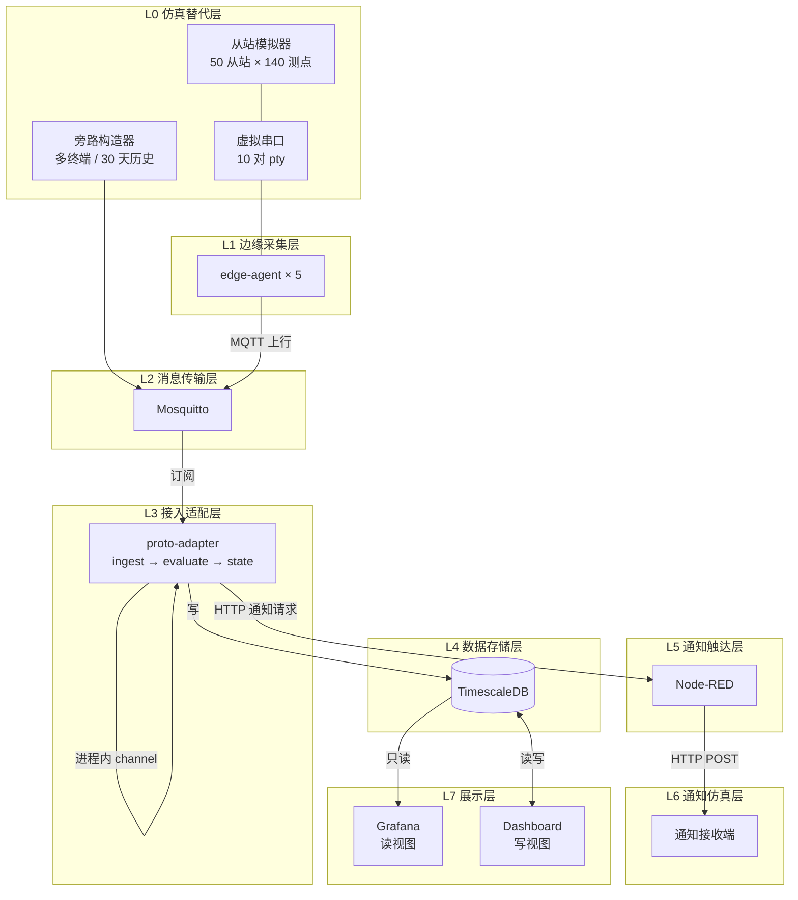
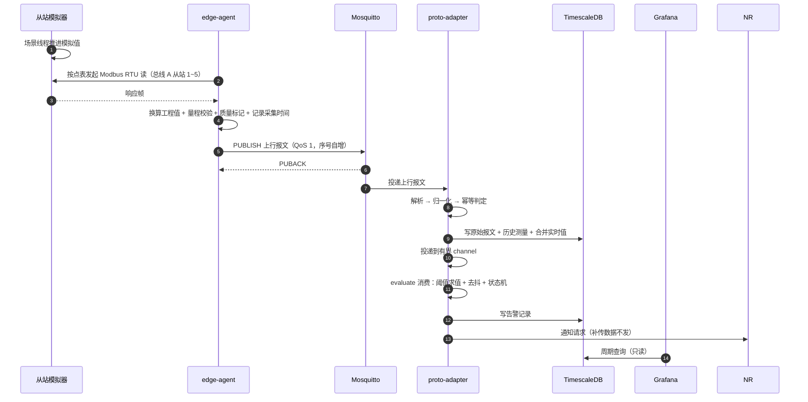
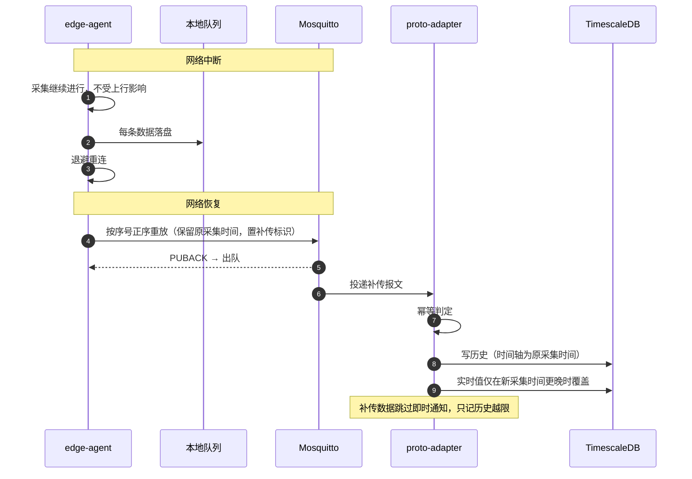

# 概要设计说明书

| 文档信息 | 内容 |
|---|---|
| 系统名称 | 车间设备状态与能耗监测系统 |
| 文档版本 | V1.0 |
| 文档性质 | 概要设计（HLD）：系统结构、组件职责、接口边界、部署形态 |
| 读者对象 | 架构、开发、测试、实施 |
| 上游文档 | [产品需求文档](../00-需求/01-产品需求文档.md)、[设备与测点模型](../00-需求/02-设备与测点模型.md)、[业务规则](../00-需求/03-业务规则.md) |
| 下游文档 | [详细设计说明书](02-详细设计说明书.md)、[数据库设计说明书](03-数据库设计说明书.md)、[接口规范](04-接口规范.md)、[架构决策记录](05-架构决策记录.md)、[协议对齐与交付边界](06-协议对齐与交付边界.md) |
| 未决事项 | [待确认项与开放决策](07-待确认项与开放决策.md) |

---

## 1. 系统概述

本系统在离散制造车间采集设备的运行状态、电能消耗与环境安全信号，汇聚到平台完成实时监视、历史分析、越限告警与通知推送。

现场部署 5 台边缘终端，每台经 RS485 总线连接 10 台传感器（每台终端 2 条总线、每条总线 5 台设备），全车间 50 台传感器、140 个测点。终端按 5 秒周期轮询读取设备的温度、振动、电流、电压、功率、电能、环境温湿度、气压以及门磁、急停、光幕等开关量，换算为工程值后经 MQTT 上报平台。平台完成入库、越限判定、告警记录与通知推送，并提供总览、实时监视、历史曲线、能耗分析、告警中心、原始报文查询等界面。

**系统解决的问题**

| 现场现状 | 系统能力 |
|---|---|
| 设备状态靠人工巡检，异常发现滞后 | 参数周期性自动采集，越限自动告警 |
| 能耗按车间总表估算，无法定位到设备 | 按设备测点采集电流、功率、电能，按车间/产线汇总 |
| 安全信号只有现场声光报警，无记录 | 开关量即时上报，形成带时间与位置的告警记录并推送通知 |
| 多车间数据各自为政 | 终端按车间归属统一纳管，提供全局总览 |

**系统边界**

- 负责：车间侧数据采集、上行传输、平台接入与存储、告警判定与通知、业务界面。
- 不负责：传感器与终端硬件选型、现场总线施工、终端固件与网管、远程控制与参数下发、企业级权限体系。

### 1.1 交付范围

| 类别 | 内容 | 性质 |
|---|---|---|
| 自研交付件 | 边缘采集应用（`edge-agent`）、平台接入服务（`proto-adapter`） | 交付产品代码 |
| 仿真件 | Modbus 从站模拟器、旁路数据构造器、通知接收端 | 验证手段，不交付实现 |
| 开源组件 | 消息代理、时序数据库、流程编排、可视化 | 直接复用，锁定版本 |
| 配置 | 终端点表、告警阈值、工况预设 | 部署时提供 |

### 1.2 建设前提

本项目在客户现场设备与终端尚未到位的条件下建设，采用软件模拟替代现场链路，形成可演示、可验收、可复用的软件基线。仿真替代的边界与真实环境的差异见 [仿真验证环境文档](../05-部署与运维/04-仿真验证环境说明.md)。

---

## 2. 总体架构

### 2.1 分层

系统分八层，每层职责单一，只与相邻层交互：

```text
L0  仿真替代层      从站模拟器 · 虚拟串口 · 旁路数据构造
L1  边缘采集层      edge-agent × 5（轮询 · 换算 · 质量 · 缓存 · 补传）
L2  消息传输层      Mosquitto（认证 · 权限隔离 · 断连通知 · 分发）
L3  接入适配层      proto-adapter（ingest 接收 · evaluate 判定 · state 状态）
L4  数据存储层      TimescaleDB（配置域 + 测量域 + 告警域）
L5  通知触达层      Node-RED（接收通知请求 · 投递 · 重试）
L6  通知仿真层      通知接收端（卡片渲染 · 投递留痕）
L7  展示层          Grafana 读视图 · Node-RED Dashboard 写视图
```



### 2.2 组件清单

| 编号 | 组件 | 层 | 性质 | 核心职责 | 不承担 |
|---|---|---|---|---|---|
| C1 | 从站模拟器 | L0 | 仿真件 | 模拟 50 台从站 / 140 测点寄存器；异常注入；工况预设 | 不写库、不做业务判断 |
| C2 | socat 虚拟串口 | L0 | 开源工具 | 提供 pty 端点对，模拟 RS485 链路 | 不做数据加工 |
| C3 | 旁路构造器 | L0 | 仿真件 | 生成多终端数据与 30 天历史 | 不用于验证采集能力 |
| C4 | edge-agent | L1 | **交付件** | 点表轮询、工程值换算、质量标记、断连通知、本地缓存与补传、健康检查 | 不做告警判定、不做业务存储、不做界面、不做协议对齐 |
| C5 | Mosquitto | L2 | 开源 | 连接认证、按终端隔离发布权限、断连通知、主题分发、持久会话 | 不解析报文内容、不入库、不做规则计算 |
| C6 | proto-adapter | L3 | **交付件** | 报文解析与归一化、幂等、原始报文留存、实时值合并、终端状态判定、阈值求值与去抖、告警状态机、补传抑制、写库 | 不做通知投递、不做界面、不定义表结构、不执行告警确认 |
| C7 | TimescaleDB | L4 | 开源 | 配置域关系存储 + 测量域时序存储 + 连续聚合降采样 | 不做业务判定、不承载文件 |
| C8 | Node-RED | L5 | 开源 | 接收通知请求、组装报文、投递、失败重试、记录投递结果 | 不做阈值求值、不做去抖、不做告警状态判定、不解析外部协议 |
| C9 | 通知接收端 | L6 | 仿真件 | 接收 Webhook、渲染卡片、留存投递记录 | 不接真实外部租户 |
| C10 | Grafana | L7 | 开源 | 读视图：总览、实时、曲线、能耗、告警、报文、导出 | 不提供写操作 |
| C11 | Node-RED Dashboard | L7 | 开源插件 | 写视图：告警确认、工况切换、演示控制 | 不做复杂分析与报表 |

C8 与 C11 是同一个 Node-RED 实例的两种用法，不额外占用组件。C4 的 5 个实例共享同一镜像，仅配置不同，计为 1 个组件。

### 2.3 数据流

| 编号 | 链路 | 路径 | 触发时机 |
|---|---|---|---|
| F1 | 采集主链路 | 寄存器 → pty → agent → MQTT → adapter → DB → Grafana | 周期定时 |
| F2 | 补传链路 | agent 本地队列 → MQTT → adapter → DB 历史 | 网络恢复 |
| F3 | 告警链路 | adapter ingest → 有界队列 → adapter evaluate → 告警表 → 通知请求 → Node-RED → 接收端 | 每批入库后 |
| F4 | 状态链路 | 断连通知 / 状态消息 / 数据超时 → adapter 判定 → 状态表 → 告警链路 | 状态变化或超时 |
| F5 | 旁路链路 | 旁路构造器 → MQTT → adapter → DB | 按需生成 |
| F6 | 配置链路 | 配置文件 → 各组件启动或重载 | 部署或变更 |
| F7 | 操作链路 | Dashboard → 告警表（确认）→ 审计字段 | 人工操作 |

**F1 一次采集到展示的完整时序**



**F2 断网补传时序**



### 2.4 接口边界

| 编号 | 接口 | 两端 | 协议 | 方向 | 契约 | 稳定性 |
|---|---|---|---|---|---|---|
| I1 | 采集接口 | 模拟器 ↔ agent | Modbus RTU over RS485 | 双向 | 接口规范 §3 | 冻结线 A |
| I2 | 上行接口 | agent → Broker | MQTT 3.1.1 / QoS 1 | 单向 | 接口规范 §5~§6 | 冻结线 A |
| I3 | 订阅接口 | Broker → adapter | MQTT 订阅 | 单向 | 接口规范 §5 | 冻结线 A |
| I4 | 持久化接口 | adapter → DB | SQL 写 | 单向 | 数据库设计 §2~§3 | 冻结线 B |
| I5 | 通知接口 | adapter → Node-RED | HTTP POST JSON | 单向 | 详细设计 §5 | 冻结线 B |
| I6 | 告警持久化 | adapter ↔ DB（含确认写） | SQL 读写 | 双向 | 数据库设计 §4 | 冻结线 B |
| I7 | 投递接口 | Node-RED → 接收端 | HTTP POST JSON | 单向 | 接口规范 §11 | 冻结线 B |
| I8 | 查询接口 | Grafana → DB | SQL 只读 | 单向 | 数据库设计 §5 | 冻结线 B |
| I9 | 操作接口 | Dashboard ↔ DB | SQL 读写 | 双向 | 数据库设计 §4 | 冻结线 B |
| I10 | 仿真控制接口 | 控制台 → 模拟器 | HTTP | 单向 | 接口规范 §12 | 不冻结 |
| I11 | 健康检查 | 服务 → 运维 | HTTP `/healthz` | 单向 | 详细设计 §6 | 不冻结 |

**冻结线定义**

```text
外部可见（客户可核对）      内部稳定（团队遵守）         内部自由（随时可改）
冻结线 A ───────────▶ 冻结线 B ───────────▶ 不冻结
I1 / I2 / I3          I4 / I5 / I6 / I7 / I8 / I9    I10 / I11 / 日志格式
改动需客户书面确认     改动需同步并回归              改动自行决定
```

冻结线 A 的变更，代码改动收敛在适配层一个组件内。若改主题名需要动展示层或建表语句，视为适配层隔离失效。

### 2.5 分层约束

| 层 | 约束 | 违规后果 |
|---|---|---|
| L0 仿真层 | 不被正式业务流程依赖 | 拆掉模拟器后系统应仍能接收旁路数据 |
| L1 边缘层 | 不直连数据库、不调用平台接口 | 破坏边缘自治与可移植性 |
| L2 传输层 | 不在 Broker 内做字段转换与入库规则 | 与适配层职责重叠，协议两处维护 |
| L3 适配层 | 不新增或修改表结构、不投递通知、不在接收段同步做阈值求值 | 换协议波及存储；同步求值拖累入库时延 |
| L4 数据层 | 不内置业务触发器做告警 | 告警逻辑分散，无法单测 |
| L5 触达层 | 不做阈值求值、去抖、告警状态判定 | 状态藏在流程上下文中，无法单测、无法版本比对 |
| L7 展示层 | 读视图不持写权限 | 破坏只读边界 |

### 2.6 数据域

| 域 | 内容 | 写入方 | 读取方 | 变化频率 |
|---|---|---|---|---|
| 配置域 | 终端、总线、设备、测点、阈值、工况 | 配置文件导入 | 全部组件 | 低 |
| 测量域 | 历史测量（含质量与三时间）、实时值 | adapter | Grafana | 高（140 点 / 周期） |
| 报文域 | 原始报文（原文 + 解析状态 + 失败原因） | adapter | Grafana | 高 |
| 事件域 | 设备离线恢复、终端上下线、缓存超限 | adapter | adapter evaluate / Grafana | 中 |
| 告警域 | 告警记录（发生 / 恢复 / 确认） | adapter evaluate（发生与恢复）、Dashboard（确认） | Grafana | 中 |
| 通知域 | 投递记录 + 失败原因 | Node-RED / 接收端 | Grafana | 中 |
| 运维域 | 服务健康、缓存积压指标 | agent / adapter | 运维 | 中 |

### 2.7 部署形态

单机容器化部署，4 核 / 8 GB 内存 / 50 GB 磁盘。按 Compose profile 分三组：

| 分组 | 组件 | 端口 | 说明 |
|---|---|---|---|
| `sim` | 从站模拟器 | 8080 | 控制接口用于改值与场景切换 |
| `edge` | edge-agent × 5 | 9101~9105 | 各挂不同配置与 pty 端点 |
| `core` | Mosquitto / proto-adapter / TimescaleDB / Node-RED / 通知接收端 / Grafana | 1883 / 9200 / 5432 / 1880·1881 / 8081 / 3000 | 平台主体 |

端口与网络规则见 [部署方案](../05-部署与运维/01-部署方案.md)。

### 2.8 故障域

| 故障 | 现象 | 降级行为 | 数据影响 |
|---|---|---|---|
| Grafana 不可用 | 界面无法访问 | 数据链路照常运行 | 无 |
| Node-RED 不可用 | 无通知推送、无告警确认入口 | 告警照常判定入库，恢复后补投递 | 无 |
| proto-adapter 不可用 | 无新数据入库 | Broker 持久会话保留消息，重启后续订 | 短暂中断 |
| 数据库不可用 | 全平台不可读 | 单点，无在线降级 | 重启恢复 |
| Broker 不可用 | 上行失败 | agent 落本地缓存，恢复后补传 | 不丢数 |
| 单台 agent 不可用 | 该终端离线 | 其余 4 台不受影响 | 该终端缓存保留 |
| 磁盘满 | 写入失败 | 按保留策略先删原始报文再删明细 | 需巡检 |

数据库与 Broker 为单点，无高可用。正式项目建议 Broker 双节点 + 数据库流复制，本期不做。

---

## 3. 边缘采集应用

### 3.1 职责

在终端上按点表周期性读取现场设备寄存器，换算为工程值，标记数据质量，经 MQTT 上报平台；上行不可用时本地持久化缓存，恢复后按序补传。

### 3.2 结构

```text
edge-agent（每终端一进程）
├── 配置加载与校验     启动时校验点表，非法即拒绝启动
├── 总线轮询协程 × N   每条总线一个协程，独立串口，互不阻塞
├── 帧编解码           Modbus RTU 请求构造、CRC16、响应解析、异常码映射
├── 工程值换算         缩放、偏移、字节序、量程校验、质量标记
├── 上报模块           MQTT 发布、断连通知（LWT）、状态消息
├── 本地队列           嵌入式 KV 存储，三上限控制
├── 补传模块           按序号正序重放，限速
└── 健康检查           /healthz
```

### 3.3 并发模型

**并发单元的数量由总线数决定**，与终端数、测点数无关。每台终端 2 条总线，故每进程 2 个轮询协程；串口是独占资源，同一条总线上的设备必须串行读取。

| 并发单元 | 数量 | 说明 |
|---|---|---|
| 进程 | 1 / 终端 | 独立部署，独立配置 |
| 轮询协程 | 1 / 总线 | 独占串口，串行读本总线设备 |
| 上报协程 | 1 / 进程 | 接收采集结果，异步发布 |
| 补传协程 | 1 / 进程 | 空闲时扫描队列重放 |
| 健康检查 | 1 / 进程 | 独立 HTTP 服务 |

采集循环与上报循环互不等待：上行断开时采集继续，数据进本地队列。

### 3.4 状态与容量

| 项 | 内容 | 持久化 |
|---|---|---|
| 消息序号 | 进程内单调递增，重启后从队列最大序号继续 | 是（随队列） |
| 本地队列 | 待上报报文 | 是 |
| 去抖与告警状态 | 无，采集侧不做判定 | — |
| 队列上限 | 7 天 / 30 万条 / 512 MB，任一先到即生效 | 是 |
| 超限行为 | 先进先出丢弃最旧，每累计 1000 条上报丢弃事件 | 是 |
| 预警线 | 任一维度达 80% 上报一次预警，同级不重复 | 是 |

### 3.5 部署形态

| 形态 | 适用 | 差异 |
|---|---|---|
| 容器 | 仿真演示，5 个实例 | 挂载配置目录与 pty 端点 |
| 静态二进制 | 终端实机 | 同一份产物，无 CGO，仅依赖串口设备节点 |

两种形态配置来源一致（文件 + 环境变量），代码零差异。

---

## 4. 平台接入服务

### 4.1 职责

订阅终端上行报文，解析并归一化为内部模型，完成幂等判定与入库；对入库数据做阈值求值与告警状态判定；生成通知请求交由触达层投递。

### 4.2 结构

```text
proto-adapter
├── ingest  接收段
│   ├── 主题路由解析        模板可配，不硬编码
│   ├── 报文解码            Codec 可切换（客户规范 / 内部标准）
│   ├── 归一化              四遥映射、单位、质量码、三时间
│   ├── 幂等判定            终端标识 + 序号
│   ├── 原始报文留存
│   └── 投影                历史测量、实时值、终端状态
│
├── channel  有界异步队列（默认容量 4096，非阻塞）
│
├── evaluate  判定段
│   ├── 阈值求值            测点级 > 总线级 > 全局
│   ├── 去抖计数            按测点维护连续计数
│   ├── 状态机              发生 → 恢复 → 确认
│   ├── 补传抑制            历史越限只记录不发通知
│   └── 通知请求            HTTP POST
│
└── state  判定状态
    ├── 活动告警集合        启动时从数据库重建
    └── 去抖计数            纯内存，不持久化
```

接收段与判定段同进程、不同协程，之间只有一条有界 channel，不共享事务、不互相调用内部函数。入库不等待判定。

### 4.3 告警判定规则

| 项 | 规则 |
|---|---|
| 触发条件 | 模拟量需连续越限 N 次确认（默认 3 次，可配）；开关量不去抖 |
| 分级 | 4 级：紧急、严重、警告、提示 |
| 优先顺序 | 同测点同时命中多条规则时，按级别取最高 |
| 闭合 | 同测点高高限触发时闭合同测点高限 |
| 恢复条件 | 未越限且去抖计数归零，写恢复时间 |
| 重复判定 | 同一去重键的活动告警不重复拉响，只累加触发次数 |
| 补传抑制 | 补传数据只记告警记录，不发通知 |
| 质量门槛 | 质量码非正常的数据不参与阈值求值 |

### 4.4 协议可换性

外部报文格式由 Codec 承担，Codec 通过配置选择。切换客户规范格式与内部标准格式时，存储、告警、界面无需改动。

四遥映射（遥测 / 遥信 / 遥控 / 遥调）以配置表外置，本期只实现遥测与遥信，遥控与遥调仅预留结构，不产生任何下行行为。

### 4.5 状态可靠性

| 状态 | 丢失后果 | 恢复方式 |
|---|---|---|
| 活动告警集合 | 已告警测点被重新拉响，违反"未恢复不重复告警" | 启动时查未恢复告警重建 |
| 去抖计数 | 告警延迟几个周期 | 不做持久化，从 0 开始 |
| 阈值快照 | 无 | 启动时载入，每 60 秒原子替换 |

---

## 5. 存储与数据

### 5.1 存储选型依据

时序数据与关系数据合并为一套数据库，避免多库带来的组件数、同步与运维成本。选中 TimescaleDB 因其同时具备关系表、时序超表、连续聚合与保留策略四项能力，且只使用其开源免费特性。

### 5.2 数据分级留存

| 数据 | 形态 | 保留 |
|---|---|---|
| 配置域 | 关系表 | 长期 |
| 历史测量明细 | 时序超表 | 7 天 |
| 度量分钟聚合 | 连续聚合 | 30 天 |
| 实时值 | 关系表，每测点 1 行 | 仅最新 |
| 原始报文 | 时序超表 | 7 天 |
| 告警与确认 | 关系表 | 长期 |
| 通知记录、设备事件 | 关系表 | 30 天 |

30 天曲线走分钟聚合而非明细留存：140 测点 × 5 秒 × 30 天约 7250 万行，单机 50 GB 磁盘无法承载明细，而产品对 30 天的要求是"可查询趋势"。

详细表结构与容量核算见 [数据库设计说明书](03-数据库设计说明书.md)。

### 5.3 数据规则

**幂等判定落点唯一**：只在适配层入库前一步判定，依据为终端标识 + 序号。其余组件不重复做幂等，避免两处判定不一致。

**三时间各司其职**

| 字段 | 产生方 | 用途 | 禁止用途 |
|---|---|---|---|
| 采集时间 | edge-agent | 业务时间轴：曲线、告警判定、排序、补传落位 | 不可被平台改写 |
| 发送时间 | edge-agent | 计算上报延迟、判断是否补传 | 不可用于业务排序 |
| 接收时间 | adapter | 计算链路延迟、排查卡顿 | 不可替代采集时间 |

**实时值只进不退**：新数据采集时间晚于当前值时才覆盖，相等时按序号取舍；补传旧数据只进历史，不进实时值。

### 5.4 数据血缘

| 阶段 | 产物 | 记录内容 |
|---|---|---|
| ① 寄存器 | 原始 16 位字 | 由模拟器生成，可人工修改 |
| ② 采集帧 | 请求 / 响应帧 | CRC 校验结果、耗时、异常码 |
| ③ 工程值 | 值 + 单位 + 质量 + 采集时间 | 换算与量程校验结果 |
| ④ 上行报文 | 报文 + 序号 + 发送时间 | 是否补传、重试次数 |
| ⑤ 入库记录 | 原文 + 解析状态 + 接收时间 | 幂等判定结果 |
| ⑥ 告警 | 告警记录 | 阈值命中、去抖计数、级别 |
| ⑦ 展示 | 曲线 / 表 / 卡片 | 按采集时间排序 |

每一步都可独立取证，这是仿真环境能被验收认可的基础。

---

## 6. 展示层

### 6.1 读写分离

| 视图 | 承担界面 | 数据库权限 |
|---|---|---|
| 读视图（分析） | 终端总览、实时监视、历史曲线、能耗视图、告警中心、原始报文、数据质量、配置查看 | 只读账号 |
| 写视图（操作） | 告警确认、工况场景切换、演示控制 | 告警表读写 |

读视图不持任何写权限，所有写操作集中在写视图一个出口。

### 6.2 界面实现分配

| 需求 | 界面 | 实现方式 |
|---|---|---|
| FR-V1 终端总览 | 读视图 | Grafana 面板，终端表 + 状态 + 告警计数 |
| FR-V2 实时监视 | 读视图 | 表格面板，5 秒刷新 |
| FR-V3 开关量状态 | 读视图 | 状态映射 + 颜色阈值 |
| FR-V4 历史曲线 | 读视图 | 时间范围变量 1h / 24h / 7d / 30d |
| FR-V5 能耗视图 | 读视图 | 分钟聚合视图，功率求均值、电能取末值差 |
| FR-V6 告警中心 | 读视图 + 写视图 | 查询在读视图，确认在写视图 |
| FR-V7 原始报文 | 读视图 | 按终端、序号、解析状态筛选 |
| FR-V8 数据导出 | 读视图 | 面板 CSV 导出 |
| FR-V9 配置查看 | 读视图 | 配置表只读视图 |

### 6.3 界面组织

- 主导航按"车间总览 → 产线 / 终端 → 设备测点"组织；
- 首页主指标为能耗总量、设备健康度、当前告警数、终端在线率；
- 视觉语义面向工业现场，界面、告警文案、通知卡片全部使用中文工业用语，禁用配电术语。

---

## 7. 通知触达

### 7.1 职责划分

| 环节 | 承担者 | 内容 |
|---|---|---|
| 判定是否通知 | adapter evaluate | 按级别与补传标记决定 |
| 生成通知标识 | adapter evaluate | 由告警唯一标识派生 |
| 组装与投递 | Node-RED | 组装卡片、HTTP 投递、失败重试 |
| 投递留痕 | Node-RED / 接收端 | 成功与失败均记录 |

触达层只做管道，不含任何业务判定。触达层不可用时告警照常判定入库，仅推送与确认不可用。

### 7.2 重试策略

| 次数 | 间隔 | 失败处理 |
|---|---|---|
| 第 1 次 | 立即 | 继续 |
| 第 2 次 | 1 秒 | 继续 |
| 第 3 次 | 5 秒 | 继续 |
| 第 4 次 | 15 秒 | 记失败原因，终止 |

通知失败不回滚告警落库，不影响告警记录完整性。

### 7.3 灰度开关

配置项关闭通知后只写"跳过"状态的投递记录，不发出请求。用于无外部通道时的演示。

---

## 8. 仿真环境

### 8.1 为什么需要

客户现场设备与终端未到位，需用软件替代现场链路，使平台侧可完整运行与验收。

### 8.2 仿真件

| 仿真件 | 替代对象 | 能力 |
|---|---|---|
| 从站模拟器 | 50 台现场传感器 | 寄存器读写、异常注入（超时 / 异常码 / CRC 错）、工况预设、值可运行时修改 |
| 虚拟串口 | RS485 物理链路 | 10 对 pty 端点，串口参数与真实一致 |
| 旁路构造器 | 多终端与 30 天历史数据 | 直接向上行主题注入数据 |
| 通知接收端 | 企业微信接收端 | Webhook 接收、卡片渲染、投递记录 |

### 8.3 验证通道纪律

| 通道 | 能证明 | 不能证明 |
|---|---|---|
| 从站模拟器 + 虚拟串口 + 采集应用 | 从现场接口读取到平台展示的完整链路 | — |
| 旁路构造器直注上行主题 | 平台接入、存储、告警、界面 | 不能证明能读 RS485 |

涉及采集能力的验收必须走第一条通道，不接受跳过采集环节直接构造平台数据。

### 8.4 规模与裁剪

全规模为 5 终端 / 10 总线 / 50 设备 / 140 测点。最小可用规模为 1 终端 / 1 总线 / 5 设备 / 14 测点，裁剪规模只减数量，不改判定条件。

---

## 9. 技术选型

### 9.1 组件版本

| 组件 | 版本 | 许可 | 交付形态 |
|---|---|---|---|
| Mosquitto | 2.0.20 | EPL-2.0 / EDL | 官方镜像 |
| TimescaleDB | 2.17.2-pg16 | Apache-2.0 + TSL | 官方镜像 |
| Node-RED | 4.0.5 | Apache-2.0 | 官方镜像 |
| Grafana | 11.3.0 | AGPL-3.0 | 官方镜像 |
| socat | 1.8.0.0 | GPL-2.0 | 官方镜像 |
| Go | 1.23.4 | BSD-3-Clause | 构建期 |
| Python | 3.12.7 | PSF | 仿真件运行时 |

全部锁定补丁版本，禁用 `latest`。

### 9.2 自研与开源边界

| 能力 | 采用 | 理由 |
|---|---|---|
| 采集应用 | 自研 Go | 需在终端受限环境运行、点表驱动轮询、顺序补传；开源网关无法同时满足且不得在终端跑 JVM / Node 运行时 |
| 协议适配与告警判定 | 自研 Go | 报文映射规则由项目定义；去抖是有状态时间窗口，属业务逻辑，无开源组件可复用 |
| 仿真件 | 自研 Python | 本身就是替代件，无开源对应物 |
| 消息代理 / 存储 / 编排 / 可视化 | 开源 | 均为成熟通用能力 |

平台侧中间件能力一律复用开源，不自研。新增模块必须能归入采集应用、适配层、仿真件三类之一。

### 9.3 语言选择

| 侧 | 语言 | 依据 |
|---|---|---|
| 交付件 | Go | 静态二进制、无运行时依赖、内存占用低，适合终端受限环境 |
| 仿真件 | Python | 开发效率高，生态成熟 |

---

## 10. 质量属性

| 属性 | 目标 | 手段 | 验证方式 |
|---|---|---|---|
| 性能 | 140 测点 5 秒周期；单终端 100 测点 10 秒为配置上限 | 每总线独立协程、批量读寄存器、异步发送 | 验收用例 AC-01、MV-09 |
| 时延 | 端到端 ≤ 采集周期 + 10 秒 | 采集到上报 ≤ 2 秒、入库 ≤ 3 秒、界面刷新 5 秒 | MV-01~MV-04 |
| 可靠性 | 断网不丢、恢复不重 | 确认后出队、持久队列、正序补传、幂等门 | AC-11~AC-13 |
| 一致性 | 实时值只进不退 | 采集时间比较 + 序号兜底 | AC-14 |
| 可观测性 | 健康检查、结构化日志、积压指标 | 各服务 `/healthz`、JSON 日志 | 部署前自检 |
| 可配置性 | 改配置不改代码 | 点表、阈值、主题模板、串口参数全外置 | AC-19 |
| 可替换性 | 换协议不影响其他 | Codec 与 Sink 双接口 + 三条冻结线 | AC-20 |
| 安全性 | 按终端隔离发布权限 | MQTT ACL + 库角色分离 + 只读账号 | AC-15 |
| 可复现性 | 从零部署复现全部用例 | Compose profile 分组 + 版本锁定 + 初始化脚本 | 全量验收 |
| 轻量化 | 单机 4 核 / 8 GB；镜像 ≤ 3 GB | 组件数与资源预算控制 | MV-10 |

界面刷新粒度为 5 秒，与产品要求的"界面刷新 ≤ 5 秒"一致。

---

## 11. 风险与降级

| 编号 | 风险 | 触发条件 | 影响 | 降级方案 |
|---|---|---|---|---|
| R-01 | 判定状态丢失 | adapter 重启 | 活动告警集合丢失导致重复告警 | 启动时从数据库重建集合；去抖计数从 0 开始 |
| R-02 | Broker 静态权限变更需重载 | 新增终端 | 新终端无法发布 | 演示期固定 5 终端，变更走脚本重载 |
| R-03 | 30 天曲线查询慢 | 聚合未刷新 | 演示卡顿 | 预刷新连续聚合，限制单次查询点数 |
| R-04 | 双入口体验割裂 | 演示动线未编排 | 观感下降 | 部署文档固化动线与跳转顺序 |
| R-05 | 单机磁盘不足 | 长期运行 | 写入失败 | 保留策略 + 部署前巡检 |
| R-06 | 容器内存争抢 | 浏览器同机运行 | 卡顿或 OOM | 内存预算 + Compose 内存上限 |
| R-07 | 虚拟串口与真实 RS485 差异 | 现场联调 | 现场异常 | 串口参数与超时全可配，预留 RTU over TCP 备用通道 |
| R-08 | 客户规范晚于交付 | 规范到位后需核对 | 少量配置改动 | Codec 可切换 + 模板配置化 |
| R-09 | 适配层膨胀为上帝对象 | 需求增加时顺手加逻辑 | 职责边界破坏 | 代码评审门禁：适配层禁止出现建表语句与通知投递代码，接收段与判定段禁止交叉调用 |
| R-10 | 判定队列积压 | 判定耗时超过入库速率 | 告警时延增大 | 有界队列 + 积压深度指标；判定侧不做 IO 阻塞，阈值配置启动时载入内存 |