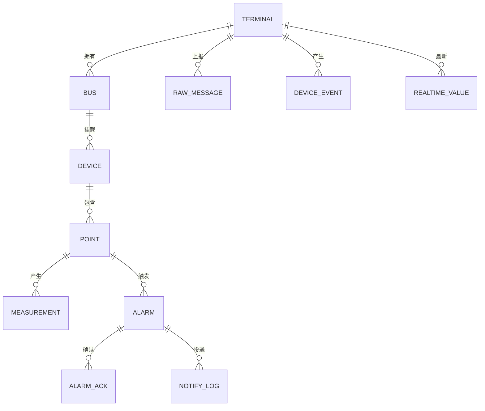

# 数据库设计说明书

| 文档信息 | 内容 |
|---|---|
| 系统名称 | 车间设备状态与能耗监测系统 |
| 数据库 | PostgreSQL 16 + TimescaleDB 2.17.2 |
| 文档版本 | V1.0 |
| 文档性质 | 数据库设计（DBD）：命名规范、表结构、索引、视图、保留策略、容量核算 |
| 读者对象 | 开发、实施、运维 |
| 上游文档 | [概要设计说明书](01-概要设计说明书.md)、[接口规范](04-接口规范.md) |

---

## 1. 总体设计

### 1.1 命名与类型规范

| 规范 | 内容 |
|---|---|
| Schema | 单一 `monitor`，`search_path=monitor,public`，避免各工具自拼路径出错 |
| 表名 | 小写单数名词，不用复数，不用前缀 |
| 时间列 | 一律 `TIMESTAMPTZ`，禁用无时区类型 |
| 枚举 | `TEXT + CHECK` 约束，不用数据库枚举类型（改值域不需迁移） |
| 布尔 | `BOOLEAN`，不用 0/1 整数 |
| 主键 | 关系表用业务键；时序表主键必须包含分区列 |

### 1.2 数据域划分



| 域 | 表 | 性质 |
|---|---|---|
| 配置域 | `terminal`、`bus`、`device`、`point`、`threshold` | 关系表，长期保留 |
| 测量域 | `measurement`、`measurement_1m`、`realtime_value` | 时序超表 + 连续聚合 + 关系表 |
| 报文域 | `message_log`、`raw_message` | 关系表 + 时序超表 |
| 事件域 | `device_event`、`terminal_state` | 关系表 |
| 告警域 | `alarm`、`alarm_ack` | 关系表，长期保留 |
| 通知域 | `notify_log` | 关系表 |
| 运维域 | `service_health` | 关系表 |

共 15 张表（含 1 个连续聚合视图）。

---

## 2. 配置域

### 2.1 表结构

```sql
CREATE SCHEMA IF NOT EXISTS monitor;
SET search_path TO monitor, public;

CREATE TABLE terminal (
  terminal_id    TEXT PRIMARY KEY,               -- 即终端序列号，全局唯一
  esn            TEXT NOT NULL UNIQUE,
  workshop       TEXT NOT NULL,
  line           TEXT NOT NULL,
  agent_version  TEXT,
  enabled        BOOLEAN NOT NULL DEFAULT TRUE,
  config_version TEXT NOT NULL,
  created_at     TIMESTAMPTZ NOT NULL DEFAULT now()
);

CREATE TABLE bus (
  terminal_id    TEXT NOT NULL REFERENCES terminal(terminal_id) ON DELETE CASCADE,
  bus_id         TEXT NOT NULL CHECK (bus_id IN ('A','B')),
  port           TEXT NOT NULL,
  baud_rate      INT NOT NULL DEFAULT 9600,
  data_bits      SMALLINT NOT NULL DEFAULT 8,
  stop_bits      SMALLINT NOT NULL DEFAULT 1,
  parity         TEXT NOT NULL DEFAULT 'N' CHECK (parity IN ('N','E','O')),
  timeout_ms     INT NOT NULL DEFAULT 1000,
  retry_count    SMALLINT NOT NULL DEFAULT 2,
  inter_frame_ms SMALLINT NOT NULL DEFAULT 4,
  PRIMARY KEY (terminal_id, bus_id)
);

CREATE TABLE device (
  terminal_id TEXT NOT NULL,
  bus_id      TEXT NOT NULL,
  slave_addr  SMALLINT NOT NULL CHECK (slave_addr BETWEEN 1 AND 247),
  device_name TEXT NOT NULL,
  device_type TEXT NOT NULL,
  PRIMARY KEY (terminal_id, bus_id, slave_addr),
  FOREIGN KEY (terminal_id, bus_id) REFERENCES bus(terminal_id, bus_id) ON DELETE CASCADE
);

CREATE TABLE point (
  terminal_id TEXT NOT NULL,
  bus_id      TEXT NOT NULL,
  slave_addr  SMALLINT NOT NULL,
  point_code  TEXT NOT NULL,
  point_id    TEXT GENERATED ALWAYS AS (bus_id || '.' || slave_addr || '.' || point_code) STORED,
  point_name  TEXT NOT NULL,
  si_type     TEXT NOT NULL CHECK (si_type IN ('YC','YX')),
  data_type   TEXT NOT NULL CHECK (data_type IN ('int16','uint16','int32','uint32')),
  addr        INT NOT NULL,
  width       SMALLINT NOT NULL CHECK (width IN (1,2)),
  scale       NUMERIC(12,6) NOT NULL,
  offset_val  NUMERIC(12,6) NOT NULL DEFAULT 0,
  unit        TEXT,
  min_value   NUMERIC(12,4),
  max_value   NUMERIC(12,4),
  PRIMARY KEY (terminal_id, bus_id, slave_addr, point_code),
  FOREIGN KEY (terminal_id, bus_id, slave_addr)
    REFERENCES device(terminal_id, bus_id, slave_addr) ON DELETE CASCADE
);
CREATE UNIQUE INDEX ux_point_global ON point (terminal_id, point_id);

CREATE TABLE threshold (
  threshold_id    BIGSERIAL PRIMARY KEY,
  alarm_type      TEXT NOT NULL,
  level           SMALLINT NOT NULL CHECK (level BETWEEN 1 AND 4),
  scope           TEXT NOT NULL CHECK (scope IN ('POINT','BUS','GLOBAL')),
  terminal_id     TEXT,
  bus_id          TEXT,
  point_code      TEXT,
  operator        TEXT NOT NULL CHECK (operator IN ('>','>=','<','<=')),
  threshold_value NUMERIC(12,4),
  debounce_count  SMALLINT NOT NULL DEFAULT 3,
  enabled         BOOLEAN NOT NULL DEFAULT TRUE,
  config_version  TEXT NOT NULL,
  CHECK ( (scope='GLOBAL' AND terminal_id IS NULL AND point_code IS NULL)
       OR (scope='BUS'    AND terminal_id IS NOT NULL AND bus_id IS NOT NULL AND point_code IS NULL)
       OR (scope='POINT'  AND terminal_id IS NOT NULL AND point_code IS NOT NULL) )
);
CREATE UNIQUE INDEX ux_threshold_scope ON threshold
  (alarm_type, scope, COALESCE(terminal_id,''), COALESCE(bus_id,''), COALESCE(point_code,''));
```

### 2.2 设计说明

| 设计点 | 说明 |
|---|---|
| `point_id` 为生成列 | 由 `总线.从站.测点编码` 拼装，保证跨终端不重号，且不依赖应用层拼字符串 |
| `terminal_id` 即序列号 | 产品约定终端以序列号为唯一标识，不另设业务编码，避免双标识映射 |
| 阈值三层作用域 | `CHECK` 约束保证作用域与字段组合自洽，避免出现"作用域为全局却带终端"的脏数据 |
| 阈值唯一索引用 `COALESCE` | 空值在唯一索引中不参与比较，用空串归并避免同一作用域重复定义 |
| 数量断言 | `point` 行数应为 5 终端 × 2 总线 × 14 测点 = 140；由配置校验 V-10 保证 |

---

## 3. 测量域

### 3.1 历史测量与聚合

```sql
CREATE TABLE measurement (
  collect_time TIMESTAMPTZ NOT NULL,
  terminal_id  TEXT NOT NULL,
  bus_id       TEXT NOT NULL,
  slave_addr   SMALLINT NOT NULL,
  point_code   TEXT NOT NULL,
  point_id     TEXT NOT NULL,
  si_type      TEXT NOT NULL,
  seq          BIGINT NOT NULL,
  value        DOUBLE PRECISION,                 -- 质量非正常时为 NULL
  quality      SMALLINT NOT NULL,
  backfill     BOOLEAN NOT NULL DEFAULT FALSE,
  send_time    TIMESTAMPTZ,
  receive_time TIMESTAMPTZ NOT NULL DEFAULT now(),
  PRIMARY KEY (collect_time, terminal_id, point_id)
);
SELECT create_hypertable('measurement','collect_time',
  chunk_time_interval => INTERVAL '1 day', if_not_exists => TRUE);

CREATE INDEX ix_measurement_point_time ON measurement (terminal_id, point_id, collect_time DESC);
CREATE INDEX ix_measurement_seq        ON measurement (terminal_id, seq);
CREATE INDEX ix_measurement_backfill   ON measurement (backfill) WHERE backfill;

CREATE MATERIALIZED VIEW measurement_1m
WITH (timescaledb.continuous) AS
SELECT time_bucket('1 minute', collect_time) AS bucket,
       terminal_id, point_id, si_type,
       avg(CASE WHEN quality = 0 THEN value END) AS avg_value,
       min(CASE WHEN quality = 0 THEN value END) AS min_value,
       max(CASE WHEN quality = 0 THEN value END) AS max_value,
       count(*) FILTER (WHERE quality = 0)       AS good_count,
       count(*)                                  AS total_count
FROM measurement
GROUP BY bucket, terminal_id, point_id, si_type
WITH NO DATA;

SELECT add_continuous_aggregate_policy('measurement_1m',
  start_offset      => INTERVAL '3 hours',
  end_offset        => INTERVAL '1 minute',
  schedule_interval => INTERVAL '1 minute');

SELECT add_retention_policy('measurement',    INTERVAL '7 days');
SELECT add_retention_policy('measurement_1m', INTERVAL '30 days');
```

**聚合只做均值、最小、最大、计数。** "末值"由 `realtime_value` 承担，避免聚合在补传乱序时取到旧值。

### 3.2 实时值

```sql
CREATE TABLE realtime_value (
  terminal_id  TEXT NOT NULL,
  point_id     TEXT NOT NULL,
  value        DOUBLE PRECISION,
  quality      SMALLINT NOT NULL,
  collect_time TIMESTAMPTZ NOT NULL,
  seq          BIGINT NOT NULL,
  updated_at   TIMESTAMPTZ NOT NULL DEFAULT now(),
  PRIMARY KEY (terminal_id, point_id)            -- 恒定 140 行
);
```

写入使用 `ON CONFLICT DO UPDATE ... WHERE` 条件更新，仅接受更晚的采集时间或同时间更大序号，保证只进不退。

### 3.3 质量码

| 码 | 含义 | 是否有值 |
|---:|---|:--:|
| 0 | 正常 | 是 |
| 1 | 通信超时 | 否 |
| 2 | 设备异常应答 | 否 |
| 3 | 校验错误 | 否 |
| 4 | 解析失败 | 否 |
| 5 | 超量程 | 是 |
| 6 | 补传 | 是 |

质量码 0 与 5 有值，其余为空。聚合只统计质量码 0 的值。

---

## 4. 报文、事件与告警域

### 4.1 幂等门与原始报文

```sql
-- 幂等判定落点唯一：插入成功即新消息，冲突即重复
CREATE TABLE message_log (
  terminal_id  TEXT NOT NULL,
  seq          BIGINT NOT NULL,
  msg_type     TEXT NOT NULL,
  collect_time TIMESTAMPTZ NOT NULL,
  receive_time TIMESTAMPTZ NOT NULL DEFAULT now(),
  backfill     BOOLEAN NOT NULL DEFAULT FALSE,
  point_count  SMALLINT,
  good_count   SMALLINT,
  bad_count    SMALLINT,
  parse_status TEXT NOT NULL,   -- OK / DUPLICATE / PARSE_ERROR / IDENTITY_MISMATCH
  fail_reason  TEXT,
  PRIMARY KEY (terminal_id, seq)
);
CREATE INDEX ix_message_log_time ON message_log (receive_time DESC);

CREATE TABLE raw_message (
  receive_time  TIMESTAMPTZ NOT NULL,
  terminal_id   TEXT,
  topic         TEXT NOT NULL,
  seq           BIGINT,
  payload       JSONB NOT NULL,                  -- 原文，不裁剪
  payload_bytes INT NOT NULL,
  parse_status  TEXT NOT NULL,
  fail_reason   TEXT,
  PRIMARY KEY (receive_time, terminal_id, seq)
);
SELECT create_hypertable('raw_message','receive_time',
  chunk_time_interval => INTERVAL '1 day', if_not_exists => TRUE);
SELECT add_retention_policy('raw_message', INTERVAL '7 days');
```

`message_log` 主键 `(terminal_id, seq)` 即幂等键。插入冲突即为重复消息，直接返回，不写历史与实时值。

### 4.2 告警

```sql
CREATE TABLE alarm (
  alarm_id        BIGSERIAL PRIMARY KEY,
  dedupe_key      TEXT NOT NULL,                 -- 终端|测点|告警类型
  terminal_id     TEXT NOT NULL,
  point_id        TEXT NOT NULL,
  alarm_type      TEXT NOT NULL,
  level           SMALLINT NOT NULL,
  status          TEXT NOT NULL CHECK (status IN ('ACTIVE','RECOVERED','ACKED','CLOSED')),
  trigger_value   DOUBLE PRECISION,
  unit            TEXT,
  threshold_value DOUBLE PRECISION,
  occur_time      TIMESTAMPTZ NOT NULL,          -- 即采集时间
  last_time       TIMESTAMPTZ NOT NULL,
  recover_time    TIMESTAMPTZ,
  trigger_count   INT NOT NULL DEFAULT 1,
  backfill        BOOLEAN NOT NULL DEFAULT FALSE,
  notify_status   TEXT CHECK (notify_status IN ('PENDING','SENT','FAILED','SKIPPED')),
  message         TEXT
);
-- 合并规则的结构级保障：同一去重键只允许一条活动告警
CREATE UNIQUE INDEX ux_alarm_active ON alarm (dedupe_key) WHERE status = 'ACTIVE';
CREATE INDEX ix_alarm_time  ON alarm (occur_time DESC);
CREATE INDEX ix_alarm_scope ON alarm (terminal_id, point_id, occur_time DESC);

CREATE TABLE alarm_ack (
  ack_id     BIGSERIAL PRIMARY KEY,
  alarm_id   BIGINT NOT NULL REFERENCES alarm(alarm_id) ON DELETE CASCADE,
  acked_by   TEXT NOT NULL,
  acked_time TIMESTAMPTZ NOT NULL DEFAULT now(),
  note       TEXT
);

CREATE TABLE notify_log (
  notify_id   TEXT PRIMARY KEY,                  -- 通知幂等键
  alarm_id    BIGINT REFERENCES alarm(alarm_id),
  channel     TEXT NOT NULL,
  status      TEXT NOT NULL CHECK (status IN ('SENT','FAILED','SKIPPED')),
  retry_count SMALLINT NOT NULL DEFAULT 0,
  http_code   INT,
  fail_reason TEXT,
  sent_time   TIMESTAMPTZ NOT NULL DEFAULT now()
);
```

部分唯一索引 `ux_alarm_active` 是"告警合并而非堆叠"的结构级保障：同一去重键在活动状态下只允许一条记录，第二次触发走 `DO UPDATE` 累加触发次数，从数据库层杜绝重复告警。

### 4.3 事件与状态

```sql
CREATE TABLE device_event (
  event_id    BIGSERIAL PRIMARY KEY,
  terminal_id TEXT NOT NULL,
  bus_id      TEXT,
  slave_addr  SMALLINT,
  event_type  TEXT NOT NULL,
  event_time  TIMESTAMPTZ NOT NULL,
  reason      TEXT,
  detail      TEXT,
  backfill    BOOLEAN NOT NULL DEFAULT FALSE
);

CREATE TABLE terminal_state (
  terminal_id    TEXT PRIMARY KEY REFERENCES terminal(terminal_id),
  status         TEXT NOT NULL CHECK (status IN ('ONLINE','OFFLINE','UNKNOWN')),
  last_data_time TIMESTAMPTZ,
  last_seen_time TIMESTAMPTZ,
  offline_reason TEXT,
  updated_at     TIMESTAMPTZ NOT NULL DEFAULT now()
);

CREATE TABLE service_health (
  checked_at TIMESTAMPTZ NOT NULL DEFAULT now(),
  service    TEXT NOT NULL,
  instance   TEXT,
  status     TEXT NOT NULL,
  detail     JSONB
);
```

---

## 5. 视图

### 5.1 视图清单

| 视图 | 用途 | 消费界面 | 数据源 |
|---|---|---|---|
| `v_point_dict` | 测点字典（车间、产线、设备名、单位） | 全部面板的标签解析 | 5 张配置表 |
| `v_realtime` | 实时值 + 数据新鲜度判定 | 实时监视、终端总览 | `realtime_value` + 字典 |
| `v_alarm_active` | 活动告警（含确认状态） | 告警中心-活动 | `alarm` + `alarm_ack` |
| `v_alarm_history` | 历史告警（按发生时间倒序） | 告警中心-历史 | `alarm` |
| `v_energy_hourly` | 车间小时能耗 | 能耗视图 | `measurement_1m` |
| `v_quality_stat` | 质量码分布与坏点率 | 数据质量看板 | `measurement` |
| `v_raw_recent` | 最近原始报文 | 原始报文页 | `raw_message` |
| `v_terminal_overview` | 终端一览（在线、最后上报、告警数） | 首页总览 | `terminal` + `terminal_state` + `alarm` |

### 5.2 关键视图定义

```sql
CREATE VIEW v_point_dict AS
SELECT p.terminal_id, p.point_id, p.point_code, p.point_name, p.si_type,
       p.unit, p.bus_id, p.slave_addr, p.min_value, p.max_value,
       d.device_name, d.device_type, t.workshop, t.line
FROM point p
JOIN device   d ON d.terminal_id = p.terminal_id AND d.bus_id = p.bus_id AND d.slave_addr = p.slave_addr
JOIN terminal t ON t.terminal_id = p.terminal_id;

CREATE VIEW v_realtime AS
SELECT r.terminal_id, r.point_id, r.value, r.quality, r.collect_time, r.seq,
       d.point_name, d.unit, d.si_type, d.bus_id, d.slave_addr,
       d.workshop, d.line, d.device_name,
       (now() - r.collect_time) > INTERVAL '30 seconds' AS is_stale
FROM realtime_value r JOIN v_point_dict d
  ON d.terminal_id = r.terminal_id AND d.point_id = r.point_id;

-- 能耗口径：功率求均值，电能取末值差，绝不求和
CREATE VIEW v_energy_hourly AS
SELECT time_bucket('1 hour', bucket) AS hour, terminal_id, point_id,
       avg(avg_value)                  AS avg_power_kw,
       max(max_value) - min(max_value) AS delta_kwh
FROM measurement_1m
WHERE point_id LIKE '%.p_total' OR point_id LIKE '%.ep_forward'
GROUP BY 1, 2, 3;

CREATE VIEW v_alarm_active AS
SELECT a.*, d.point_name, d.unit AS point_unit, d.workshop, d.device_name,
       (a.status <> 'ACKED') AS need_ack,
       (SELECT ack.acked_time FROM alarm_ack ack
         WHERE ack.alarm_id = a.alarm_id ORDER BY ack.acked_time DESC LIMIT 1) AS acked_time,
       (SELECT ack.acked_by   FROM alarm_ack ack
         WHERE ack.alarm_id = a.alarm_id ORDER BY ack.acked_time DESC LIMIT 1) AS acked_by
FROM alarm a LEFT JOIN v_point_dict d
  ON d.terminal_id = a.terminal_id AND d.point_id = a.point_id
WHERE a.status IN ('ACTIVE','RECOVERED');
```

### 5.3 查询硬规则

| 规则 | 要求 | 原因 |
|---|---|---|
| 时间必填 | 任何 `measurement` 查询必须带时间过滤 | 无时间条件会扫描全部分区 |
| 按范围选源 | 窗口 ≤ 24 小时用明细表；> 24 小时必须用聚合表 | 30 天明细约 7000 万行 |
| 点数上限 | 单条曲线 `LIMIT 2000`，超出由前端降采样 | 渲染与传输 |
| 禁止全表计数 | 统计限定时间窗口或走聚合表 | 大表全表计数会全扫 |
| 时区固定 | 面板统一 `Asia/Shanghai`，SQL 内不做时区换算 | 避免两处口径不一致 |
| 只读角色 | 全部读视图走只读数据源 | 读写分离边界 |

**视图内不写 `now()` 时间过滤。** 时间条件若写进视图，PostgreSQL 无法下推分区裁剪，30 天曲线会退化为全量扫描。

---

## 6. 权限

| 角色 | 权限范围 | 用途 |
|---|---|---|
| `workshop_owner`（属主） | 全部 | 部署与迁移 |
| `workshop_readonly` | `SELECT` 于全部表与视图 | 读视图数据源 |
| `workshop_adapter` | 配置域只读；测量、报文、告警、事件读写；无 `alarm_ack` 写 | 接入服务 |
| `workshop_dashboard` | `alarm` 与 `alarm_ack` 读写；配置域只读 | 写视图（告警确认） |
| `workshop_notify` | `notify_log` 读写；配置域只读 | 编排层 |

读视图不持写权限，写操作集中在写视图与接入服务。

---

## 7. 保留与清理

```sql
-- 超表由保留策略自动清理
-- 关系表由接入服务每日 03:00 定时删除
DELETE FROM message_log   WHERE receive_time < now() - INTERVAL '30 days';
DELETE FROM device_event  WHERE event_time   < now() - INTERVAL '30 days';
DELETE FROM notify_log    WHERE sent_time    < now() - INTERVAL '30 days';
DELETE FROM service_health WHERE checked_at  < now() - INTERVAL '7 days';
```

| 对象 | 机制 | 保留 |
|---|---|---|
| `measurement` | 超表保留策略 | 7 天 |
| `measurement_1m` | 连续聚合保留策略 | 30 天 |
| `raw_message` | 超表保留策略 | 7 天 |
| `message_log` | 定时删除 | 30 天 |
| `device_event` / `notify_log` | 定时删除 | 30 天 |
| `service_health` | 定时删除 | 7 天 |
| `alarm` / `alarm_ack` | 不清理 | 长期 |
| 配置域 | 不清理，随配置版本追加 | 长期 |

---

## 8. 容量核算

| 项 | 计算 | 结果 |
|---|---|---|
| 明细写入速率 | 140 测点 ÷ 5 秒 | 28 行/秒 |
| 明细日增 | 28 × 86400 | 约 240 万行 |
| 明细 7 天 | 240 万 × 7，含索引 | 约 1700 万行 / 4.2 GB |
| 聚合 30 天 | 140 测点 × 1440 分钟 × 30 天 | 约 604 万行 / 0.6 GB |
| 原始报文 7 天 | 按 5 终端 × 17280 条/天 × 7 | 约 0.9 GB |
| **合计** | | **约 6 GB，占 50 GB 的 12%** |

余量说明：50 GB 中数据库约占 6 GB，其余留给镜像（约 1.2 GB）、日志与系统。若验收要求 30 天 5 秒明细，需扩容磁盘并调整保留策略——按 30 天计约 7250 万行，约 18 GB。

---

## 9. 初始化与种子

| 步骤 | 脚本 | 内容 |
|---|---|---|
| 1 | `init/01_schema.sql` | 建 schema、15 张表、超表、连续聚合、保留策略、索引、视图、角色 |
| 2 | `init/02_seed.sql` | 由 `make seed-sql` 从配置文件生成、`make seed` 导入：5 终端 / 10 总线 / 50 设备 / 140 测点 / 95 行阈值 |
| 3 | `init/03_grant.sql` | 角色授权 |

种子数据由配置文件生成而非手写，保证数据库与配置文件一致。两者不一致时以文件为准并重新生成。

`02_seed.sql` 由 `cmd/config-tool seed` 生成并入库（只在 `config/` 变更时重新生成），
内容是一条事务：先 `DELETE FROM threshold` / `DELETE FROM terminal`（级联清 bus / device / point），
再按文件重建，因此可重复导入。**只重建配置域**，测量、报文、告警等业务表不受影响。

阈值行数是 95 而不是 15：`config/thresholds.json` 的 15 条是规则模板，
按「终端 × 测点」展开成 `POINT` 作用域的行（`ia`/`ib`/`ic` 共用一条高限即展开 3 行）。
D-04 的期望值因此是 95；若只数模板条数，那是 15。

**初始化断言**（部署后自检执行）：

| 编号 | 断言 | 期望 |
|---|---|---|
| D-01 | `SELECT count(*) FROM point` | 140 |
| D-02 | `SELECT count(*) FROM terminal` | 5 |
| D-03 | `SELECT count(*) FROM device` | 50 |
| D-04 | `SELECT count(*) FROM threshold` | 95（15 条模板按终端 × 测点展开；含单点覆盖） |
| D-05 | `measurement` 是超表 | 是 |
| D-06 | `measurement_1m` 连续聚合存在且策略启用 | 是 |
| D-07 | 保留策略生效 | 明细 7 天、聚合 30 天 |
| D-08 | `ux_alarm_active` 部分唯一索引存在 | 是 |
| D-09 | `realtime_value` 行数 | 首轮采集后 140 |