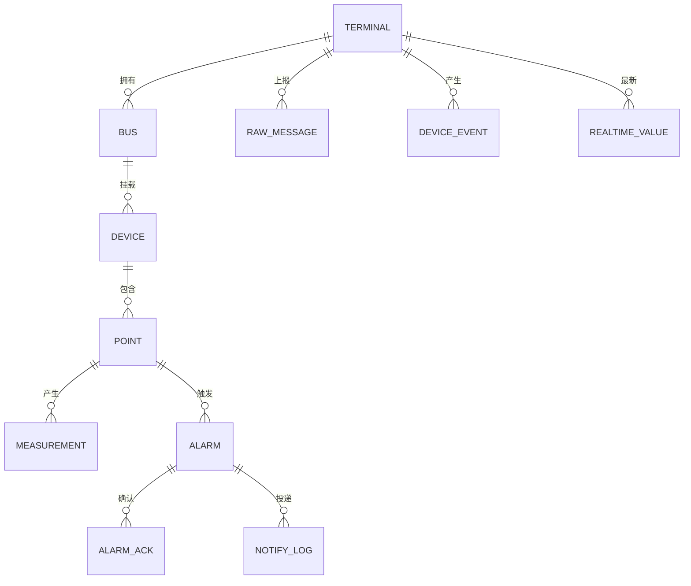

# 接口规范

| 文档信息 | 内容 |
|---|---|
| 系统名称 | 车间设备状态与能耗监测系统 |
| 文档版本 | V1.0 |
| 文档性质 | 接口规范：跨组件必须共同遵守的协议、报文结构与字段定义 |
| 读者对象 | 开发、测试、客户技术对接 |
| 上游依据 | [产品需求文档](../00-需求/01-产品需求文档.md)、[设备与测点模型](../00-需求/02-设备与测点模型.md)、[业务规则](../00-需求/03-业务规则.md)、[概要设计说明书](01-概要设计说明书.md) |
| 适用范围 | 从站模拟器、虚拟串口、edge-agent、Mosquitto、proto-adapter、Node-RED、通知接收端、Grafana、旁路构造器 |
| 冻结级别 | 第 3、5.1~5.2、6、9 章为**冻结线 A**（客户可核对，改动需书面确认）；第 5.3、7、11 章为冻结线 B |

> 本文档定义"跨组件必须共同遵守的协议与字段"。表结构与索引见[数据库设计说明书](03-数据库设计说明书.md)，模块与算法见[详细设计说明书](02-详细设计说明书.md)。
>
> 本文档中的点表是**仿真契约**：正式项目须替换为终端厂家与真实传感器寄存器表，替换方式是改配置，不是改代码。

---

## 1. 契约范围与冻结线

### 1.1 本文档覆盖什么

| 序号 | 内容 | 对应章节 | 需求依据 |
|---:|---|---|---|
| 1 | Modbus RTU 接入方式、串口参数、寄存器点表、数据类型与换算 | 3 | FR-E1~E3、C-01、交付前提与边界 §3 P-E01 |
| 2 | MQTT 连接参数、会话、LWT、认证与 ACL | 4 | FR-T1、FR-T4~T6、C-02、交付前提与边界 §3 P-E01 |
| 3 | Topic 双套命名、映射与订阅通配 | 5 | FR-T2、FR-T7、FR-I5、交付前提与边界 §2 |
| 4 | 数据 / 事件 / 状态三类上行报文 Schema | 6 | FR-T2、FR-T3、FR-T8、交付前提与边界 §2 |
| 5 | 判定侧输入数据（adapter `ingest` → `evaluate`，进程内） | 7 | FR-A1~A9 |
| 6 | 数据质量码定义 | 8 | P-03 §4、FR-E3、FR-I7 |
| 7 | 序号、幂等、补传、缓存参数 | 9 | P-03 §1、§5、FR-I2、FR-E5~E7 |
| 8 | 时间字段语义与禁止用法 | 10 | P-03 §2、FR-E4、FR-I4 |
| 9 | 阈值与告警契约 | 11 | P-02 §5、FR-A1~A5 |
| 10 | 仿真器控制接口 | 12 | 仿真验证环境说明 §4 IM-S3~S8 |
| 11 | 平台查询与视图口径 | 13 | FR-V1~V9 |
| 12 | 数据模型、保存与保留要求 | 14 | P-01 §6.2、FR-I3、FR-V4 |
| 13 | 版本与兼容规则 | 15 | NFR-3 |
| 14 | 扩展数据类型定义（本期不实现） | 附录 A | P-02 §3 数据格式说明 |

### 1.2 三条冻结线（与 04 §4.2 一致）

```text
冻结线 A（客户可核对，改需书面确认）
  ├─ §3 Modbus 寄存器点表
  ├─ §5 Topic 名称与层级
  └─ §6 Payload 字段与语义

冻结线 B（团队内部稳定，改需同步 4 处并回归）
  ├─ §5.3 内部通知接口（HTTP）
  ├─ §7 判定侧输入数据（进程内）
  ├─ §11 告警与通知报文
  └─ §13 查询视图口径

不冻结（内部自由）
  ├─ §12 控制接口
  ├─ 日志格式
  └─ 健康检查返回体
```

> **硬规则**：冻结线 A 的变更，代码改动必须收敛在 `proto-adapter` 一个组件内。
> 若改一个 Topic 字符串需要动 Grafana 面板或建表语句，即判定适配层隔离失败。

---

## 2. 术语与标识规则

### 2.1 术语

| 术语 | 定义 |
|---|---|
| 融合终端 | 智芯微边缘物联代理设备，本案例中运行 edge-agent，一个终端对应一个车间 |
| 总线 busId | 终端下的一路 RS485 物理通道，取值 `A` / `B` |
| 传感器（设备） | 挂在总线上的一台 Modbus 从站，由 `busId + slaveAddr` 定位 |
| 测点 pointCode | 传感器内部的单个寄存器量，如 `motor_temp` |
| 采集时间 collectTime | edge-agent 完成本批读帧解析的时刻 |
| 发送时间 sendTime | 报文实际 PUBLISH 的时刻 |
| 接收时间 receiveTime | proto-adapter 收到报文的时刻 |
| 补传 backfill | 因 MQTT 不可用而本地缓存、恢复后重发的数据 |
| RTU over TCP | Modbus RTU 帧经 TCP 传输，**不等同于** Modbus TCP（无 MBAP 头） |

### 2.2 标识组合规则（交付前提与边界 §2）

| 标识 | 格式 | 示例 | 唯一性范围 |
|---|---|---|---|
| `terminalId` | **直接取终端 ESN** | `ESN-ZX-0001` | 全局 |
| `busId` | `A` / `B` | `A` | 终端内 |
| `slaveAddr` | 1 ~ 247，本期固定 1~5 | `1` | 总线内 |
| `deviceId` | `{terminalId}.{busId}.{slaveAddr}` | `ESN-ZX-0001.A.1` | 全局 |
| `pointCode` | 小写下划线，见 §3.3 | `motor_temp` | 传感器内 |
| `pointId` | `{busId}.{slaveAddr}.{pointCode}` | `A.1.motor_temp` | 终端内 |
| **测点全局键** | `{terminalId}/{pointId}` | `ESN-ZX-0001/A.1.motor_temp` | **全局唯一** |
| `msgId` | `{terminalId}-{seq}`（seq 左补 8 位） | `ESN-ZX-0001-00010245` | 全局 |

**规则**

1. 测点全局键是存储、告警、界面三处的唯一关联依据，任何组件不得自行拼接其他形式。
2. ESN 长度与字符集以客户物联管理平台要求为准；客户规范到位前，本案例使用 `ESN-ZX-` + 4 位数字作为**交付基线值**（演示取值），长度与字符集由终端配置 `esnPattern` 约束，切换方法见 §17.2。
3. `busId` 大写单字母，不做数字编号，避免与 `slaveAddr` 混淆。
4. `pointCode` 一经发布不得改名（改名等于新建测点，历史数据断链）。

---

## 3. Modbus 接入契约（冻结线 A）

### 3.1 支持模式

| 模式 | 本期要求 | 说明 |
|---|---|---|
| Modbus RTU over 虚拟串口（pty） | **必须** | 正式验收链路，模拟 RS485 两线制总线 |
| Modbus RTU over TCP | 可选 | 开发联调用，帧结构不变，仅承载介质不同 |
| Modbus TCP（MBAP） | **不纳入** | P-01 §3.2 非范围 |

### 3.2 串口与轮询参数

| 参数 | 默认值 | 可配置 | 说明 |
|---|---:|---|---|
| 波特率 | 9600 | 是 | 需与真实传感器一致 |
| 数据位 / 停止位 / 校验 | 8 / 1 / N | 是 | 现场若为 8/E/1 需同步改模拟器与点表 |
| 响应超时 | 1000 ms | 是 | 超时即判 `TIMEOUT` |
| 重试次数 | 2 | 是 | 重试仍失败才计一次失败 |
| 帧间隔（RTU 静默） | ≥ 3.5 字符时间 | 是 | 9600 波特率下约 4 ms |
| 采集周期 | **5 s**（演示）/ 30 s（生产惯例） | 是 | P-02 §7、第 10 章 |
| 功能码 | **03（读保持寄存器）** | 否 | 14 个测点全部用 03，遥信也以 uint16 承载 |
| 单次读取上限 | 125 寄存器 | 否 | 本案例单从站最大 7 个 |

**帧数与耗时核算（单条总线一个周期）**

| 从站 | 请求帧 | 响应帧 | 合计字节 |
|---:|---:|---:|---:|
| 1 电机状态监测仪（2 寄存器） | 8 | 9 | 17 |
| 2 三相电量仪表（7 寄存器） | 8 | 19 | 27 |
| 3 温湿度变送器（2 寄存器） | 8 | 9 | 17 |
| 4 安全状态模块（3 寄存器） | 8 | 11 | 19 |
| 5 气压变送器（1 寄存器） | 8 | 7 | 15 |
| **合计** | 40 | 55 | **95** |

> 9600 bps / 8N1 时每字节约 1.04 ms，95 字节约 99 ms，加 10 个帧间隔约 40 ms，**单总线周期约 140 ms**；
> 10 条总线并行时总耗时仍约 140 ms，5 秒周期余量充足，**且支持降至 1 秒周期**。

### 3.3 寄存器点表（单条总线模板，14 测点）

10 条总线**共用同一模板**，仅 `busId` 与 `terminalId` 不同，寄存器地址完全一致。

| 从站 | 设备名称 | 功能码 | 寄存器地址 | 宽 | pointCode | 测点名称 | 四遥 | 数据类型 | 字节序 | 缩放 | 单位 | 量程 |
|---:|---|---:|---|---:|---|---|---|---|---|---:|---|---|
| 1 | 电机状态监测仪 | 03 | 0x0000 | 1 | `motor_temp` | 电机绕组温度 | YC | int16 | AB | 0.1 | ℃ | -20 ~ 200 |
| 1 | 电机状态监测仪 | 03 | 0x0001 | 1 | `motor_vib` | 电机振动速度 | YC | uint16 | AB | 0.01 | mm/s | 0 ~ 50 |
| 2 | 三相电量仪表 | 03 | 0x0000 | 1 | `ia` | A 相电流 | YC | uint16 | AB | 0.01 | A | 0 ~ 200 |
| 2 | 三相电量仪表 | 03 | 0x0001 | 1 | `ib` | B 相电流 | YC | uint16 | AB | 0.01 | A | 0 ~ 200 |
| 2 | 三相电量仪表 | 03 | 0x0002 | 1 | `ic` | C 相电流 | YC | uint16 | AB | 0.01 | A | 0 ~ 200 |
| 2 | 三相电量仪表 | 03 | 0x0003 | 1 | `uab` | 线电压 | YC | uint16 | AB | 0.1 | V | 0 ~ 500 |
| 2 | 三相电量仪表 | 03 | 0x0004 | 1 | `p_total` | 有功功率 | YC | uint16 | AB | 0.01 | kW | 0 ~ 600 |
| 2 | 三相电量仪表 | 03 | 0x0005 | **2** | `ep_forward` | 正向有功电能 | YC | **uint32** | **AB CD** | 0.01 | kWh | 0 ~ 42949672.95 |
| 3 | 温湿度变送器 | 03 | 0x0000 | 1 | `env_temp` | 车间环境温度 | YC | int16 | AB | 0.1 | ℃ | -20 ~ 60 |
| 3 | 温湿度变送器 | 03 | 0x0001 | 1 | `env_humi` | 车间环境湿度 | YC | uint16 | AB | 0.1 | %RH | 0 ~ 100 |
| 4 | 安全状态采集模块 | 03 | 0x0000 | 1 | `door` | 安全门磁 | YX | uint16 | AB | 1 | — | 0 闭合 / 1 打开 |
| 4 | 安全状态采集模块 | 03 | 0x0001 | 1 | `estop` | 急停按钮 | YX | uint16 | AB | 1 | — | 0 正常 / 1 按下 |
| 4 | 安全状态采集模块 | 03 | 0x0002 | 1 | `light_curtain` | 安全光幕 | YX | uint16 | AB | 1 | — | 0 通光 / 1 遮挡 |
| 5 | 气压变送器 | 03 | 0x0000 | 1 | `air_pressure` | 压缩空气压力 | YC | uint16 | AB | 0.001 | MPa | 0 ~ 1.6 |

> **读请求块划分**：按从站整块读取，不从中间切分。即每周期对每个从站发 1 次请求，
> 从站 2 一次读 7 个寄存器（0x0000~0x0006），从站 4 一次读 3 个（0x0000~0x0002）。
> 这样每总线每周期 5 帧，**不是 14 帧** —— 这是保证 5 秒周期可行的关键约定。

### 3.4 数据类型与字节序规则

| 数据类型 | 寄存器数 | 解析规则（AB CD 大端） |
|---|---:|---|
| `int16` | 1 | 16 位补码有符号 |
| `uint16` | 1 | 16 位无符号 |
| `uint32` | 2 | **高字在前**：`value = (reg[addr] << 16) + reg[addr+1]`，再按缩放换算 |
| `int32` | 2 | 同上，按 32 位补码解析 |
| `float32` | 2 | **本期不实现**，定义见附录 A |

1. 全部测点使用 **大端（AB）**；`ep_forward` 使用 **AB CD**（高字在前、每字内大端）。
2. `ep_forward` 是本期唯一多寄存器测点，专门用于验证长整型拼装与溢出处理（P-02 §3 选型说明）。
3. 字节序切换（CDAB 等）本期不开放，配置项保留但不生效（附录 A）。

### 3.5 工程值换算

```text
原始值 → 按数据类型解析 → 原始值 × scale + offset → 量程校验 → 工程值
量程校验：工程值 ∉ [minValue, maxValue] → 保留数值，quality = 5 (OUT_OF_RANGE)
```

- 浮点结果按 `round(value, 10^⌈-log10(scale)⌉)` 保留小数，避免 `0.30000000000000004`；
- **换算只在 edge-agent 做一次**。模拟器只写原始寄存器值，平台只存工程值，禁止重复缩放（V1.0 遗留风险点）。

### 3.6 异常映射

| 现场现象 | 判据 | quality | value |
|---|---|---:|---|
| 无响应 / 超时 | 超过 timeoutMs（含重试） | 2 TIMEOUT | `null` |
| 从站返回异常码 | 帧第 3 字节 bit7=1 | 1 DEVICE_EXCEPTION | `null` |
| CRC 校验失败 | CRC16 不匹配 | 3 CRC_ERROR | `null` |
| 帧长度或格式不符 | 长度 ≠ 5+2N | 4 PARSE_ERROR | `null` |
| 数值超出量程 | 工程值越界 | 5 OUT_OF_RANGE | 保留数值 |
| 正常 | — | 0 GOOD | 数值 |

> 异常码细分（01/02/03/04）记录在 `detail` 字段，用于 SIM-17 取证；
> **任何异常都不得沿用上一次正常值**（P-03 §4 第 18 条）。

### 3.7 点表配置结构（配置驱动，FR-E10）

```json
{
  "terminalId": "ESN-ZX-0001",
  "configVersion": "1.0.0",
  "workshop": "一号车间",
  "line": "机加工产线",
  "collectIntervalMs": 5000,
  "publishBatch": false,
  "buses": [
    {
      "busId": "A",
      "mode": "rtu-serial",
      "port": "/dev/ttyV0",
      "baudRate": 9600, "dataBits": 8, "stopBits": 1, "parity": "N",
      "timeoutMs": 1000, "retryCount": 2, "interFrameMs": 4,
      "devices": [
        {
          "slaveAddr": 1,
          "name": "电机状态监测仪",
          "type": "motor_monitor",
          "blocks": [
            {
              "functionCode": 3, "startAddr": 0, "registerCount": 2,
              "points": [
                { "code": "motor_temp", "name": "电机绕组温度", "addr": 0, "width": 1,
                  "dataType": "int16", "byteOrder": "AB", "scale": 0.1, "offset": 0,
                  "unit": "℃", "minValue": -20, "maxValue": 200, "siType": "YC" },
                { "code": "motor_vib", "name": "电机振动速度", "addr": 1, "width": 1,
                  "dataType": "uint16", "byteOrder": "AB", "scale": 0.01, "offset": 0,
                  "unit": "mm/s", "minValue": 0, "maxValue": 50, "siType": "YC" }
              ]
            }
          ]
        }
      ]
    }
  ]
}
```

**结构约束（实施必须遵守）**

| 约束 | 原因 |
|---|---|
| `blocks` 按从站内的连续地址块组织，一个块一次请求 | 决定帧数与周期可行性（§3.3） |
| `points[].addr` 是**块内偏移**，不是绝对地址 | 与 Modbus 请求的 `startAddr` 解耦 |
| `siType` 只允许 `YC` / `YX` | 四遥分类必须显式声明（T8） |
| `pointId` 不写入配置，由 `busId.slaveAddr.code` 派生 | 避免配置与标识不一致 |
| `configVersion` 为语义化版本号 | 写入 `terminal.config_version`；版本变化才记配置加载事件（V-12），否则每次启动都记一条 |
| `points[].name` 为展示名称，`code` 为标识 | `code` 一经使用不得改名（§2.2 规则 4），展示名称可随时调整 |
| 校验失败即拒绝启动并输出明确错误 | FR-E10、`configuration_error` 事件 |

字段的完整形状与取值域见 `config/schema/terminal.schema.json`；`V-01~V-11` 的语义校验由
`cmd/config-tool verify` 执行，两者不重复、不互相替代。

---

## 4. MQTT 连接契约

### 4.1 连接参数

| 参数 | 取值 | 说明 |
|---|---|---|
| 协议版本 | **MQTT 3.1.1**（统一） | 兼容性最好；5.0 特性本期不用，字段位预留 |
| ClientId | `edge-{terminalId}` | 一终端一连接，重启复用同一 ClientId |
| 认证 | 用户名 + 口令，按终端发放独立账号 | P-01 §7安全 |
| QoS | **数据 / 事件 / 状态一律 QoS 1** | 至少一次，靠幂等兜住重复 |
| Clean Session | **false**（持久会话） | Broker 侧保留订阅与离线消息 |
| Session Expiry Interval | 0（3.1.1 无此字段，服务端会话永久保留） | 5.0 迁移时置 `3600` |
| Keep Alive | 30 s | 3 个周期内可识别掉线 |
| Retain | 数据 / 事件**不保留**；状态**保留** | 新订阅者可立即拿到终端最后状态 |
| Payload 编码 | UTF-8 JSON，中文直出 | ADR-09：可人工逐字段核对（SIM-19） |
| 时间单位 | **Unix 毫秒时间戳（int64）** | P-01 §7时钟 |
| 遗嘱 LWT | Topic = 状态主题，Payload = `status=OFFLINE, reason=UNEXPECTED_DISCONNECT`，QoS 1，Retain | FR-E5、FR-I5 |
| 重连 | 自动重连，指数退避 1s → 2s → 4s … 上限 30 s | 避免恢复瞬间冲击 |

### 4.2 认证与 ACL（按终端隔离）

| 主体 | 发布权限 | 订阅权限 |
|---|---|---|
| `edge-ESN-ZX-0001` ~ `0005` | 仅 `/edge/ESN-ZX-000x/data/up`、`/event/up`、`/status/up` | 无 |
| `bypass-sim` | 仅 `/edge/bypass-*/#` | 无 |
| `adapter` | 无（通知走 HTTP，见 §5.3） | `/edge/+/+/up`、`/edge/+/status/up` |
| `node-red` | 无 | 无（不接触任何 MQTT 主题） |

1. ACL 由 Mosquitto `acl_file` 静态定义（ADR-02 已记录代价：改权限需重载）。
2. 终端账号**不得**订阅任何 `down` 主题（交付前提与边界 §2 第 23 条：本期无下行）。
3. 5 个终端账号 + 2 个内部账号，共 7 个，终端新增需同步改 ACL 并重载。
4. **`adapter` 的 `/internal/#` 发布权限已撤销、`node-red` 的订阅权限已撤销**：
   告警判定下沉到 adapter 后，两组件之间改为 HTTP 通知请求（架构见 ADR-1），
   不再经消息代理转发内部事件。

---

## 5. Topic 契约（冻结线 A）

### 5.1 双套命名与配置开关（交付前提与边界 §2）

| 业务类型 | 国网对齐（`scheme=grid`，**默认**） | 内部标准（`scheme=internal`） |
|---|---|---|
| 测点数据上行 | `/edge/{esn}/data/up` | `/workshop/{esn}/data/up` |
| 设备事件上行 | `/edge/{esn}/event/up` | `/workshop/{esn}/event/up` |
| 终端状态上行 | `/edge/{esn}/status/up` | `/workshop/{esn}/status/up` |
| 命令下行（预留） | `/edge/{esn}/cmd/down` | `/workshop/{esn}/cmd/down` |
| 参数下发（预留） | `/edge/{esn}/param/down` | `/workshop/{esn}/param/down` |

- 切换开关：环境变量 `MQTT_TOPIC_SCHEME=grid|internal`，**所有组件读同一变量**；
- 主题模板的唯一来源是 `config/topics.json`，代码里不出现主题字符串；两套方案**同形、仅前缀不同**，
  因此 adapter 的订阅通配在两种方案下是同一组模式（§5.2）；
- 两套命名承载**完全相同的 Payload**，差异仅在主题字符串 → 映射为 1:1；
- 下行两类**仅占位**，本期不实现、不订阅、不发布（P-01 §3.2 非范围）。
- **客户规范到位后的切换路径**：两套命名即"通用模板 ↔ 客户命名"的落地手段之一；若客户主题结构与模板差异较大，只**在 `config/topics.json` 新增第三套模板**，不动 §6 Payload 与下游组件（切换清单见 §17.2）。

### 5.2 上行 Topic 实例清单（5 终端）

| 终端 | 数据 | 事件 | 状态（Retain） |
|---|---|---|---|
| ESN-ZX-0001 | `/edge/ESN-ZX-0001/data/up` | `/edge/ESN-ZX-0001/event/up` | `/edge/ESN-ZX-0001/status/up` |
| ESN-ZX-0002 | `/edge/ESN-ZX-0002/data/up` | `/edge/ESN-ZX-0002/event/up` | `/edge/ESN-ZX-0002/status/up` |
| ESN-ZX-0003 | `/edge/ESN-ZX-0003/data/up` | `/edge/ESN-ZX-0003/event/up` | `/edge/ESN-ZX-0003/status/up` |
| ESN-ZX-0004 | `/edge/ESN-ZX-0004/data/up` | `/edge/ESN-ZX-0004/event/up` | `/edge/ESN-ZX-0004/status/up` |
| ESN-ZX-0005 | `/edge/ESN-ZX-0005/data/up` | `/edge/ESN-ZX-0005/event/up` | `/edge/ESN-ZX-0005/status/up` |

**订阅通配（adapter）**：`/{prefix}/+/+/up`，一条订阅覆盖全部 15 个上行主题；
`prefix` 取 `edge`（`scheme=grid`）或 `workshop`（`scheme=internal`），同样来自 `config/topics.json`。

> 状态主题也在 `.../up` 下，故 `/{prefix}/+/+/up` 已包含三类主题，不需要第二条订阅。
> 若实际客户规范把状态主题定义为 `/edge/{esn}/status`（无 `/up`），**只需改配置模板，不改代码**。

### 5.3 内部通知接口（冻结线 B，已由 MQTT 主题族改为 HTTP）

> **本节已按 ADR-1 修订**。原方案定义了三个内部 MQTT 主题族
> （`/internal/v2/{esn}/measurement`、`device-event`、`terminal-state`），
> 由 adapter 发布、Node-RED 订阅并执行阈值求值。
> 告警判定下沉到 adapter 后，**该主题族整体取消**，改为单一 HTTP 通知接口。

| 接口 | 双方 | 形式 | 用途 |
|---|---|---|---|
| `POST {NOTIFY_ENDPOINT}` | proto-adapter → Node-RED | HTTP POST(JSON) | 告警已判定成立，请求投递通知 |

**为什么取消主题族**：原设计把"每条测点数据"和"设备事件"都序列化出去，
是为了让编排层能独立判定。判定下沉后这条链路没有接收方——
再保留主题族就等于把每条数据额外序列化一次再丢弃。

**字段定义**见详细设计说明书 §4.1。此处只冻结三件事：

| 冻结项 | 取值 |
|---|---|
| 传输 | HTTP POST，`Content-Type: application/json` |
| 发起方 | 只能是 proto-adapter（单一出口） |
| `notifyId` 生成方 | **proto-adapter**，格式 `NT-{terminalId}-{pointId}-{occurTime}` |

> 内部通知接口**不参与**国网对齐，不受 O-08 影响；这是把外部命名风险关在适配层内部的手段。
> 与外部 Topic 契约（冻结线 A）的隔离至此更为彻底：内部已无 MQTT 主题，改外部命名不可能波及通知链路。

---

## 6. 上行报文契约（冻结线 A）

### 6.1 数据消息（`msgType = DATA`）

```json
{
  "header": {
    "schemaVersion": "2.0",
    "msgType": "DATA",
    "msgId": "ESN-ZX-0001-00010245",
    "esn": "ESN-ZX-0001",
    "seq": 10245,
    "collectTime": 1793500200123,
    "sendTime": 1793500200230,
    "backfill": false,
    "timeSync": true
  },
  "body": {
    "busId": "A",
    "yc": [
      { "code": "motor_temp", "slaveAddr": 1, "value": 62.5,  "unit": "℃",  "quality": 0 },
      { "code": "motor_vib",  "slaveAddr": 1, "value": 2.35,  "unit": "mm/s","quality": 0 },
      { "code": "ia",         "slaveAddr": 2, "value": 35.2,  "unit": "A",   "quality": 0 },
      { "code": "ib",         "slaveAddr": 2, "value": 34.8,  "unit": "A",   "quality": 0 },
      { "code": "ic",         "slaveAddr": 2, "value": 36.1,  "unit": "A",   "quality": 0 },
      { "code": "uab",        "slaveAddr": 2, "value": 382.4, "unit": "V",   "quality": 0 },
      { "code": "p_total",    "slaveAddr": 2, "value": 21.48, "unit": "kW",  "quality": 0 },
      { "code": "ep_forward", "slaveAddr": 2, "value": 12345.67, "unit": "kWh", "quality": 0 },
      { "code": "env_temp",   "slaveAddr": 3, "value": 28.4,  "unit": "℃",  "quality": 0 },
      { "code": "env_humi",   "slaveAddr": 3, "value": 56.5,  "unit": "%RH", "quality": 0 },
      { "code": "air_pressure","slaveAddr": 5,"value": 0.62,  "unit": "MPa", "quality": 0 }
    ],
    "yx": [
      { "code": "door",          "slaveAddr": 4, "value": 0, "quality": 0 },
      { "code": "estop",         "slaveAddr": 4, "value": 0, "quality": 0 },
      { "code": "light_curtain", "slaveAddr": 4, "value": 0, "quality": 0 }
    ],
    "stat": { "total": 14, "good": 14, "bad": 0 }
  }
}
```

**为什么一个周期只发 1 条消息（含 14 点）而不是 14 条**

| 方案 | 消息数/周期/终端 | 140 点全网 QPS | 结论 |
|---|---:|---:|---|
| 每测点 1 条 | 28 | 28 | Broker 与 adapter 压力 28 倍，且幂等键粒度变碎 |
| **每批 1 条（采用）** | **1** | **1** | 5 台终端 1 条/5s = 1 msg/s，`seq` 语义清晰 |

> 单报文约 3 KB（14 点），与 P-03 §5 的容量测算一致。

### 6.2 字段定义

| 字段 | 类型 | 必填 | 说明 |
|---|---|:--:|---|
| `header.schemaVersion` | string | ✓ | 本文档版本，`2.0` |
| `header.msgType` | enum | ✓ | `DATA` / `EVENT` / `STATUS` |
| `header.msgId` | string | ✓ | `{esn}-{seq:08d}` |
| `header.esn` | string | ✓ | 必须与 Topic 中的 `{esn}` 完全一致，不一致判 `IDENTITY_MISMATCH` |
| `header.seq` | int64 | ✓ | 终端内单调递增，重启不归零（§9.1） |
| `header.collectTime` | int64 | ✓ | 本批读帧解析完成时刻，毫秒 |
| `header.sendTime` | int64 | ✓ | 本次 PUBLISH 时刻，补传时更新 |
| `header.backfill` | bool | ✓ | 是否补传 |
| `header.timeSync` | bool | ✓ | 终端时钟是否已同步；`false` 时平台记录并对时间轴打标 |
| `body.busId` | string | ✓ | `A` / `B` |
| `body.yc[]` | array | ✓ | 遥测数组，失败点 `value=null` 但**不得剔除** |
| `body.yx[]` | array | ✓ | 遥信数组，同上 |
| `body.yc[].code` | string | ✓ | 测点编码，对应 §3.3 |
| `body.yc[].slaveAddr` | int | ✓ | 从站地址 |
| `body.yc[].value` | number/null | ✓ | 工程值；异常时 `null` |
| `body.yc[].unit` | string | ✓ | 单位，取自点表 |
| `body.yc[].quality` | int | ✓ | 质量码，见 §8 |
| `body.stat.total/good/bad` | int | ✓ | 本批统计，供质量看板与 SIM-17 取证 |

**`header` 字段构成（口径声明）**

| 分组 | 字段 | 说明 |
|---|---|---|
| 规范字段（**8 个**） | `schemaVersion` / `msgType` / `msgId` / `esn` / `seq` / `collectTime` / `sendTime` / `backfill` | 与《国网边缘物联代理接入规范》对齐的报文头，对应交付前提与边界 §2、P-E03 所称"8 个报文头字段" |
| 本地扩展（**1 个**） | `timeSync` | 本项目扩展，用于时钟异常取证（P-03 §2、§10 规则 2）。客户规范若禁止扩展字段，可关闭该字段，但将失去时间轴可信度标记 |

> 因此全量 `header` 共 **9 个字段 = 8 规范字段 + 1 扩展字段**。P-01 与 05 的"8 字段"指规范字段部分，两处口径已对齐，非矛盾。

**强制规则**

1. 采集失败的测点**必须在数组中出现且 `value=null`**，不得省略。省略会让"没采"和"没这个点"无法区分。
2. `esn` 与 Topic 不一致时整条报文判解析失败，仍留存原文（FR-I7）。
3. 同一 `seq` 内的 `yc` + `yx` 点数必须等于 `stat.total`，否则判 `PARSE_ERROR`。

### 6.3 国网对齐字段映射表（交付基线版本）

| 本文档字段 | 语义 | 国网规范对应字段（**基线取值，由 交付前提与边界 P-E03 对外确认**） | 对齐状态 |
|---|---|---|---|
| `header.esn` | 设备唯一标识 | `deviceId` / `esn` | ✅ 语义已对齐，字段名待核对 |
| `header.msgType` | 报文类型 | `msgType` | ✅ |
| `header.seq` | 报文序号 | `msgSeq` | ✅ 语义对齐 |
| `header.collectTime` | 采集时间 | `sampleTime` / `dataTime` | ✅ 语义对齐 |
| `header.sendTime` | 发送时间 | `sendTime` | ✅ |
| `body.yc[]` | 遥测 | `yc` / `analog` | ✅ 四遥分类对齐 |
| `body.yx[]` | 遥信 | `yx` / `digital` | ✅ |
| `body.yc[].quality` | 数据质量 | `quality` / `valid` | ✅ |
| — | 遥控 YK | `yk` | 🔲 **仅预留，本期不产生** |
| — | 遥调 YT | `yt` | 🔲 **仅预留，本期不产生** |
| — | 台区 / 线路标识 | `tgId` / `lineId` | ❌ **不对齐**（A 基调，不建模，置空不发送） |

> **对齐判定**：9 项已实现字段中 8 项语义已对齐、字段名以通用模板为准；1 项（质量码）取值域以本文件 §8 的 0~8 定义为基线。
> 台区/线路两类字段按 交付前提与边界 §2「判定口径」明确**排除**：无法映射到车间测点，本期不采纳。
>
> **基线声明**：客户物联管理平台的接入规范**在合作确认后才可取得**（交付前提与边界 §3），本案例交付时尚未获得。
> 因此本表以**国网通用模板**为基线冻结，字段名保留客户可能采用的别名（`/` 分隔）；
> 客户规范到位后按 §17.2 切换清单修改本表即可，**不触发代码、存储或界面变更**。

### 6.4 事件消息（`msgType = EVENT`）

```json
{
  "header": {
    "schemaVersion": "2.0", "msgType": "EVENT",
    "msgId": "ESN-ZX-0001-00010246", "esn": "ESN-ZX-0001", "seq": 10246,
    "collectTime": 1793500320123, "sendTime": 1793500320180,
    "backfill": false, "timeSync": true
  },
  "body": {
    "eventType": "SENSOR_OFFLINE",
    "busId": "A",
    "slaveAddr": 1,
    "eventTime": 1793500320123,
    "reason": "CONTINUOUS_TIMEOUT",
    "failureCount": 5,
    "detail": "modbus read timeout after 2 retries"
  }
}
```

| `eventType` | 含义 | 触发条件 | 平台动作 |
|---|---|---|---|
| `SENSOR_OFFLINE` | 传感器离线 | 连续 **5** 次采集失败（P-03 §6(16)） | 生成传感器离线告警（FR-A5） |
| `SENSOR_RECOVERED` | 传感器恢复 | 离线后首次成功读取 | 闭合离线告警，记恢复时间（FR-A4） |
| `CACHE_WARNING` | 缓存占用达 80% | 三上限任一达阈值 | 生成提示级告警，同级不重复 |
| `CACHE_DROPPED` | 缓存丢弃 | 累计丢弃每满 1000 条 | 记录事件，不单独告警 |
| `CONFIGURATION_ERROR` | 配置错误 | 点表校验失败 | 记录并拒绝启动该总线 |

> 事件也占用 `seq`（递增），与数据共享同一序号空间，便于整体还原时序（§9.1）。

### 6.5 状态消息（`msgType = STATUS`，Retain）

```json
{
  "header": {
    "schemaVersion": "2.0", "msgType": "STATUS",
    "msgId": "ESN-ZX-0001-00010247", "esn": "ESN-ZX-0001", "seq": 10247,
    "collectTime": 1793500380123, "sendTime": 1793500380130,
    "backfill": false, "timeSync": true
  },
  "body": {
    "status": "ONLINE",
    "statusTime": 1793500380123,
    "reason": "CONNECTED",
    "uptimeSec": 3600,
    "cacheDepth": 0,
    "cacheBytes": 0,
    "agentVersion": "1.0.0"
  }
}
```

| `status` | `reason` | 触发 |
|---|---|---|
| `ONLINE` | `CONNECTED` | 连接建立后主动发布（Retain） |
| `OFFLINE` | `UNEXPECTED_DISCONNECT` | Broker 代发 LWT（Retain） |
| `OFFLINE` | `GRACEFUL_SHUTDOWN` | 正常退出前主动发布 |

**终端在线判定的三源合成（FR-I5）**

| 信号源 | 判据 | 权重 |
|---|---|---|
| 状态消息 / LWT | 收到 `OFFLINE` | 立即离线 |
| 数据超时 | 超过 **3 个上报周期** 无 DATA | 判离线（90 s @30s 周期） |
| 状态心跳 | `ONLINE` 且持续有数据 | 在线 |

> 三者缺一都会误判：只看 LWT 时进程假死不会掉线；只看数据超时时补传报文会误判在线。

---

## 7. 判定侧输入数据（进程内结构，非网络契约）

> **本章已按 ADR-1 修订**。原为"内部事件契约"，定义了 adapter → Node-RED 的 MQTT 报文。
> 告警判定下沉到 adapter 内部后，这些字段不再经过网络序列化，**降级为进程内结构**。
> 之所以仍在本契约文档中保留定义：`ingest` 与 `evaluate` 是两个必须能独立测试的模块，
> 其间的数据结构仍需冻结，否则模块边界会随实现漂移。

`ingest` 归一化后投递到有界 channel，**与国网格式无关**，是隔离外部协议变更的关键边界。

### 7.1 测点判定输入

```json
{
  "terminalId": "ESN-ZX-0001",
  "pointId": "A.1.motor_temp",
  "busId": "A",
  "slaveAddr": 1,
  "pointCode": "motor_temp",
  "siType": "YC",
  "value": 62.5,
  "unit": "℃",
  "quality": 0,
  "collectTime": 1793500200123,
  "receiveTime": 1793500200350,
  "backfill": false,
  "seq": 10245
}
```

| 字段 | 说明 |
|---|---|
| `siType` | `YC` / `YX`，决定走阈值分支还是状态分支 |
| `backfill` | **补传抑制的唯一依据**（不用"collectTime 比现在早多少"判断） |
| `quality` | `≠0` 的点**不参与阈值求值**（FR-A1 前置条件） |
| `collectTime` | 唯一业务时间轴；判定与告警发生时间都用它 |

> **`eventId` 字段已移除**：原设计中它是跨组件的幂等键，需要防 MQTT QoS1 的重复投递。
> 现在投递是进程内有界 channel，不产生网络重复，幂等由 `(terminalId, seq)` 在入库前已解决。

### 7.2 设备事件与终端状态

沿用 §6.4 / §6.5 的 `body`，额外带上 `terminalId` 与 `workshop` 两个字段。
带上 `workshop` 是为了让 `evaluate` 组通知请求时不必反查配置表——
判定侧应保持零阻塞 IO（04 §20 A5 实现约束）。

---

## 8. 数据质量码（冻结线 A）

| quality | 名称 | `value` 规则 | 说明 |
|---:|---|---|---|
| 0 | `GOOD` | number | 正常 |
| 1 | `DEVICE_EXCEPTION` | `null` | 从站返回异常码 |
| 2 | `TIMEOUT` | `null` | 通信超时（含重试） |
| 3 | `CRC_ERROR` | `null` | CRC 校验失败 |
| 4 | `PARSE_ERROR` | `null` | 长度/格式/类型不符 |
| 5 | `OUT_OF_RANGE` | **保留数值** | 超出工程值量程 |
| 6 | `STALE` | number / null | 数据陈旧（平台侧判定，不由终端产生） |
| 7 | `SIMULATED` | number | 旁路仿真数据（IM-S12） |
| 8 | `MANUAL` | number | 人工注入值（IM-S3） |

**规则**

1. `quality ≤ 4` 时 `value` 必须为 `null`；`5/6/7/8` 保留数值。
2. 平台不得把 `quality ≠ 0` 的数据写入实时值的"正常值"口径，也不得参与越限判定。
3. 界面展示"最近一次正常值"时必须同屏标注该值的时间与质量（P-03 §4 第 20 条）。
4. `7/8` 仅用于演示取证，**不得出现在 SIM-01~SIM-14 的核心验收证据中**（仿真验证环境说明 §3）。

---

## 9. 序号、幂等与补传（冻结线 A）

### 9.1 序号 `seq`

1. 范围：单个 `terminalId` 内单调递增，起点 1；
2. **重启不归零**：启动时从本地持久化读取 `max(seq)` 并继续；
3. 数据、事件、状态**共享同一序号空间**，任一条消息占用一个 `seq`；
4. 断网期间 `seq` 继续递增（缓存即分配），补传时按 `seq` 正序重放；
5. 同一批内 `yc` + `yx` 全部共享该 `seq`。

### 9.2 幂等

| 层级 | 幂等键 | 判定位置 | 命中处理 |
|---|---|---|---|
| 消息级 | `terminalId + seq` | **adapter 写库前一步** | 不写历史、不写实时值、不投递判定队列，仅累加"重复计数"指标 |
| 测点级 | `terminalId + pointId + collectTime` | 同上 | 兜底，防同 seq 不同点集合的异常报文 |
| 通知级 | `notifyId` | Node-RED 入口 | 丢弃重复请求，防重复推送 |

> **只在 adapter 做一次消息级幂等**。Node-RED 与 Grafana **不得**再做同一判断，否则两处口径会不一致（04 §5.4 规则 1）。
> 通知级幂等是另一回事：它防的是"同一告警被推送两次"，不是"同一数据被入库两次"。

### 9.3 补传

1. MQTT 发布失败 → 立即落本地持久队列，**不得丢弃**；
2. 队列项至少保存：`seq`、`collectTime`、`topic`、`payload`、`firstFailTime`、`retryCount`；
3. 网络恢复后按 `seq` **正序**重放；重放时保留原 `collectTime`、更新 `sendTime`、置 `backfill=true`；
4. **只有收到 PUBACK 才允许出队**（P-03）；
5. 补传限速：单批 ≤ 500 条、批间隔 ≥ 50 ms；
6. **补传期间 RS485 采集循环不得暂停**（P-03 §5 第 11 条，SIM-11 关键判据）。

### 9.4 缓存三上限（P-03 §5 冻结值）

| 维度 | 冻结值 | 触发动作 |
|---|---|---|
| 保留时长 | **7 天** | 删除超期项 |
| 报文条数 | **30 万条** | FIFO 删最旧 |
| 磁盘占用 | **512 MB** | FIFO 删最旧 |
| 预警 | 任一维度 **80%** | 上报一次 `CACHE_WARNING` |

- 任一维度先到即生效；
- 丢弃按批处理（每累计 1000 条）上报一次 `CACHE_DROPPED`，避免事件风暴；
- 丢弃必须留痕，**禁止静默丢弃**。

---

## 10. 时间规则

| 时间 | 产生方 | 用途 | **禁止用途** |
|---|---|---|---|
| `collectTime` | edge-agent | 曲线横轴、告警判定、事件排序、补传落位 | 不可被平台改写 |
| `sendTime` | edge-agent | 计算上报延迟、识别补传 | 不可用于业务排序 |
| `receiveTime` | adapter | 计算链路延迟、排查卡顿 | **不可替代 collectTime**（P-03 §2 第 8 条） |

1. 全部毫秒级 Unix 时间戳（int64），不用字符串时间；
2. 各容器与终端需启用 NTP 或统一注入时间，漂移 > 5 s 视为时钟异常，`timeSync=false`；
3. 历史曲线按 `collectTime` 分组，跨终端比较时统一换算到平台时区（默认 `Asia/Shanghai`）；
4. 补传数据的 `collectTime` 早于当前时刻是**正常现象**，平台不得因此拒收。

---

## 11. 阈值与告警契约（冻结线 B）

### 11.1 阈值表（P-02 §5 逐条落地，按总线复制 × 10）

| 编号 | pointCode | 告警类型 | 判据 | 级别 | 去抖 |
|---|---|---|---|---:|---|
| TH-01 | `motor_temp` | 高限 | `> 85` | 2 警告 | 连续 3 次 |
| TH-02 | `motor_temp` | 高高限 | `> 105` | 3 严重 | 连续 3 次 |
| TH-03 | `motor_vib` | 高限 | `> 4.5` | 2 警告 | 连续 3 次 |
| TH-04 | `motor_vib` | 高高限 | `> 11.2` | 3 严重 | 连续 3 次 |
| TH-05 | `ia` / `ib` / `ic` | 高限 | `> 80` | 2 警告 | 连续 3 次 |
| TH-06 | `ia` / `ib` / `ic` | 高高限 | `> 100` | 3 严重 | 连续 3 次 |
| TH-07 | `uab` | 低限 | `< 342` | 2 警告 | 连续 3 次 |
| TH-08 | `uab` | 高限 | `> 418` | 2 警告 | 连续 3 次 |
| TH-09 | `env_temp` | 高限 | `> 35` | 2 警告 | 连续 3 次 |
| TH-10 | `env_humi` | 高限 | `> 80` | 2 警告 | 连续 3 次 |
| TH-11 | `air_pressure` | 低限 | `< 0.45` | 2 警告 | 连续 3 次 |
| TH-12 | `air_pressure` | 高限 | `> 0.75` | 2 警告 | 连续 3 次 |
| TH-13 | `door` | 状态报警 | `= 1` | 3 严重 | **不去抖** |
| TH-14 | `estop` | 状态报警 | `= 1` | 4 紧急 | **不去抖** |
| TH-15 | `light_curtain` | 状态报警 | `= 1` | 4 紧急 | **不去抖** |

> 级别数值见 §11.3。阈值随点表按总线复制，**可按测点单独覆盖**（配置优先级：测点 > 总线 > 全局）。

### 11.2 告警类型枚举

| `alarmType` | 中文 | 触发源 | 去抖 |
|---|---|---|---|
| `HIGH_LIMIT` | 高限 | 阈值求值 | 有 |
| `HIGH_HIGH_LIMIT` | 高高限 | 阈值求值 | 有 |
| `LOW_LIMIT` | 低限 | 阈值求值 | 有 |
| `STATE_ALARM` | 状态报警 | 遥信求值 | 无 |
| `SENSOR_OFFLINE` | 传感器离线 | `device-event` | 无 |
| `TERMINAL_OFFLINE` | 终端离线 | `terminal-state` + 超时 | 无 |
| `CACHE_WARNING` | 缓存预警 | `device-event` | 无 |
| `DATA_QUALITY_ERROR` | 数据质量异常 | 连续 N 点 `quality≠0` | 有 |

### 11.3 告警级别

| `level` | 中文 | 用途 | 通知策略 |
|---:|---|---|---|
| 1 | 提示 | 缓存预警、质量异常 | 仅入库 |
| 2 | 警告 | 一般越限 | 入库 + 通知（5 分钟合并） |
| 3 | 严重 | 高高限、门磁 | 入库 + 立即通知 |
| 4 | 紧急 | 急停、光幕 | 入库 + 立即通知（置顶） |

### 11.4 告警生命周期与合并

```text
发生 → 活动（active） → 恢复（recovered） → 确认（acked） → 归档
```

| 规则 | 内容 |
|---|---|
| 合并 | 同一 `terminalId + pointId + alarmType` 只保留**一条**活动告警，重复命中只更新 `lastTime` 与 `triggerValue` |
| 恢复 | 判据回到阈值内且连续 3 次（与去抖对称），写 `recoverTime` |
| 分级 | 高高限触发时，同时闭合同测点的低级别（高限）活动告警，避免叠加刷屏 |
| 补传抑制 | `backfill=true` 时不发通知（FR-A8），仅落库并在告警上标 `backfill=true` |
| 时间轴 | 发生/恢复全部用 `collectTime`，不用 `receiveTime`（FR-A9） |
| 确认 | 只允许从 Dashboard 发起，记录 `ackedBy` / `ackedTime`（FR-A6） |

### 11.5 通知报文（Node-RED → wecom-mock，FR-N1~N4）

`POST {WECOM_WEBHOOK_URL}`

```json
{
  "notifyId": "NT-ESN-ZX-0001-A.1.motor_temp-1793500200123",
  "channel": "wecom-mock",
  "msgtype": "markdown",
  "alarm": {
    "alarmId": "AL-0000123",
    "level": 3,
    "levelText": "严重",
    "workshop": "一号车间",
    "terminalId": "ESN-ZX-0001",
    "deviceText": "电机状态监测仪 · 总线A · 从站1",
    "pointText": "电机绕组温度",
    "alarmType": "HIGH_HIGH_LIMIT",
    "alarmTypeText": "高高限",
    "triggerValue": 108.0,
    "unit": "℃",
    "threshold": 105,
    "occurTime": 1793500200123,
    "reason": "连续 3 次超过高高限 105 ℃",
    "backfill": false
  },
  "markdown": {
    "content": "**【严重】电机绕组温度高高限**\n> 车间：一号车间\n> 终端：ESN-ZX-0001\n> 设备：电机状态监测仪 · 总线A · 从站1\n> 触发值：**108.0 ℃**（阈值 105 ℃）\n> 采集时间：2026-10-26 09:30:00\n> 原因：连续 3 次超过高高限"
  }
}
```

| 字段 | 必填 | 说明 |
|---|:--:|---|
| `notifyId` | ✓ | 幂等键，模拟端据此去重（重试不产生重复卡片） |
| `msgtype` | ✓ | `markdown`（企业微信机器人风格） |
| `alarm.*` | ✓ | 结构化字段，供模拟端渲染与后续接真实通道 |
| `markdown.content` | ✓ | 已渲染文本，接真实通道时可直接复用 |
| `alarm.backfill` | ✓ | 为 `true` 时模拟端标灰，明确"历史补传" |

- 失败重试 3 次（1s/5s/15s），仍失败写 `notify_log.status=FAILED` + 原因；
- **通知失败不阻塞告警落库**（FR-N4）；
- 切换真实通道：仅改 `WECOM_WEBHOOK_URL` 与 `WECOM_ENABLED`，报文结构不变（FR-N4）。

---

## 12. 仿真器控制接口（不冻结）

### 12.1 Modbus 从站模拟器（IM-S3~S5、IM-S8）

| 接口 | 方法 | 请求体 | 用途 |
|---|---|---|---|
| `/api/v1/reg/{busId}/{slaveAddr}/{addr}` | PUT | `{"value":625}` | 写原始寄存器（**不缩放**，625 表示 62.5 ℃） |
| `/api/v1/reg/{busId}/{slaveAddr}` | GET | — | 读回该从站全部寄存器 |
| `/api/v1/offline/{busId}/{slaveAddr}` | POST | — | 暂停响应（触发 SIM-09） |
| `/api/v1/online/{busId}/{slaveAddr}` | POST | — | 恢复响应（触发 SIM-10） |
| `/api/v1/fault/{busId}/{slaveAddr}` | POST | `{"mode":"timeout\|exception\|crc","count":5}` | 注入异常（SIM-17） |
| `/api/v1/scene/{name}` | POST | — | 工况预设：`normal` / `alarm` / `safety` |
| `/api/v1/health` | GET | — | 健康检查 |

**工况预设定义（IM-S8，演示节奏关键）**

| 场景 | 动作 |
|---|---|
| `normal` | 全部测点置正常值，清异常注入，清门磁/急停/光幕 |
| `alarm` | 绕组温度 → 108 ℃、A 相电流 → 85 A、气压 → 0.38 MPa（覆盖高高限/高限/低限三类） |
| `safety` | 门磁=1、急停=1、光幕=1（触发紧急级告警与通知） |

### 12.2 旁路仿真器（IM-S9~S12）

| 接口 | 方法 | 用途 |
|---|---|---|
| `/api/v1/generate` | POST | 生成历史数据，体：`{"terminals":5,"days":30,"intervalSec":300,"backfillQuality":7}` |
| `/api/v1/stream/start` | POST | 开始按实时节奏推流 |
| `/api/v1/stream/stop` | POST | 停止 |
| `/api/v1/scene/{name}` | POST | 同 12.1 |

> 旁路仿真器一律使用 `quality=7 (SIMULATED)`，并在 Topic 中使用 `bypass-*` 前缀终端标识，
> **不得冒充真实终端参与 SIM-01~SIM-14 验收**（仿真验证环境说明 §3）。

---

## 13. 平台查询与视图口径（不冻结）

### 13.1 页面能力 → 数据口径

| 页面 | 主要数据源 | 关键口径 | FR |
|---|---|---|---|
| 终端总览 | `terminal` + `realtime_value` 汇总 | 在线状态按 §6.5 三源合成 | FR-V1 |
| 实时监视 | `realtime_value` | 只显示 `collectTime` 最新值，非最新章节标质量 | FR-V2、FR-V3 |
| 历史曲线 | `measurement`（1h/24h/7d）+ `measurement_1m`（7d/30d） | 横轴 = `collectTime` | FR-V4 |
| 能耗视图 | `measurement` 中 `p_total` / `ep_forward` | 按车间汇总，电能取**末值差**不取累加 | FR-V5 |
| 告警中心 | `alarm` + `alarm_ack` | 活动/历史分栏，按 `occurTime` 倒序 | FR-V6 |
| 原始报文 | `raw_message` | 可按 `terminalId` / `seq` / `parseStatus` 筛 | FR-V7 |
| 数据导出 | 同历史曲线 | CSV，时间按 `collectTime`，含质量列 | FR-V8 |
| 配置查看 | `point` / `threshold` | 与配置文件一致，只读 | FR-V9 |

### 13.2 导出字段约定（FR-V8）

```text
terminalId,workshop,busId,slaveAddr,pointCode,pointName,siType,value,unit,quality,collectTime,sendTime,backfill
```

- 时间导出为 `yyyy-MM-dd HH:mm:ss.SSS`（本地时区），**不导出 epoch**；
- `value=null` 导出为空串，不导出 `0`；
- 单次导出上限 20 万行，超出提示缩小范围。

### 13.3 能耗口径（易错点，FR-V5）

| 指标 | 口径 | 说明 |
|---|---|---|
| 有功功率汇总 | 各车间 `p_total` **求和** | 功率是瞬时量，可比相加 |
| 电能消耗 | `ep_forward` **末值 − 首值** | 电能是累计量，**不得求和**，否则数值放大 N 倍 |

---

## 14. 数据模型与保存要求

### 14.1 业务对象（概念级，物理表见 04 第二部分）



| 对象 | 关键属性 | 说明 |
|---|---|---|
| Terminal | `terminalId`（=ESN）、车间、产线、在线状态、最后上报时间 | 5 条 |
| Bus | `busId`、串口参数 | 10 条 |
| Device | `terminalId`+`busId`+`slaveAddr`、设备名称、类型 | 50 条 |
| Point | `pointId`、`pointCode`、数据类型、缩放、单位、量程、`siType` | 140 条 |
| Measurement | 测点全局键、值、质量、`collectTime`、`seq`、`backfill` | 明细 7 天 + 分钟聚合 30 天 |
| RawMessage | Topic、原文、`receiveTime`、解析状态、失败原因 | 7 天 |
| DeviceEvent | 事件类型、对象、时间、原因 | 30 天 |
| Alarm | 类型、级别、触发值、发生/恢复/确认、通知状态 | 长期 |
| NotifyLog | 投递记录、状态、失败原因 | 30 天 |

### 14.2 保存与保留

| 数据 | 保留 | 依据 |
|---|---|---|
| 配置域（terminal/bus/device/point/threshold） | 长期 | FR-V9 |
| `measurement` 明细 | **7 天** | 04 §5.2、容量 |
| `measurement_1m` 分钟聚合 | **30 天** | FR-V4 |
| `raw_message` | 7 天 | P-01 §7 |
| `realtime_value` | 仅最新 1 行/测点 | FR-I6 |
| `alarm` / `alarm_ack` | 长期 | FR-A4、FR-V6 |
| `notify_log` | 30 天 | FR-N3 |
| `device_event` | 30 天 | SIM-09/10 |

### 14.3 实时值更新规则（FR-I6）

```text
允许更新 ⟺ incoming.collectTime > current.collectTime
时间相等 ⟹ 按 seq 大者胜；seq 也相等 ⟹ 幂等命中，忽略
backfill = true ⟹ 只写历史，不碰 realtime_value
```

---

## 15. 版本与兼容

| 规则 | 内容 |
|---|---|
| Schema 版本 | `header.schemaVersion` 必填，本版 `2.0` |
| 兼容新增 | 同一大版本内只允许加**可选字段**，接收方必须忽略未知字段 |
| 不兼容变更 | 删字段、改类型、改语义 → 升大版本并同步改 Topic 大版本 |
| Topic 版本 | 与 Schema 大版本保持一致（`v2` ↔ `2.x`；国网对齐方案下由 `schemaVersion` 承载） |
| 锁版本 | 联调与验收使用的版本在《03 手册》中锁定并写入证据 |
| 回滚 | 保留上一版本镜像与 Schema 常量，可 30 分钟内回滚 |

---

## 16. 需求回溯矩阵（50 条 FR + 15 条仿真件需求 → 契约章节）

| 需求组 | 条数 | 契约落点 | 说明 |
|---|---:|---|---|
| IM-S1~S2 | 2 | §3.3 点表 | 10 总线 × 5 从站 × 14 点 |
| IM-S3 | 1 | §12.1 控制接口 | 写原始寄存器 |
| IM-S4 | 1 | §12.1 | offline/online |
| IM-S5 | 1 | §3.6、§12.1 | 异常注入 + 质量映射 |
| IM-S6 | 1 | §3.1、§3.2 | pty + 串口参数 |
| IM-S7~S8 | 2 | §12.1 场景 | 波动与工况预设 |
| IM-S9~S12 | 4 | §12.2、§8 | 旁路数据必须 `quality=7` |
| FR-E1~E2 | 2 | §3.3~§3.5 | 轮询与换算 |
| FR-E3 | 1 | §3.6、§8 | 质量码 |
| FR-E4 | 1 | §5、§6.1 | QoS1 + Payload |
| FR-E5 | 1 | §4.1 LWT、§6.5 | |
| FR-E6~E7 | 2 | §9.3、§9.4 | 补传与缓存 |
| FR-E8 | 1 | §6.4 | 离线/恢复事件 |
| FR-E9 | 1 | §3.7 | 配置结构 |
| FR-E10 | 1 | §12.1 `/health`、§6.5 | 自检与最后采集值 |
| FR-T1~T2 | 2 | §5.2、§6.1 | QoS1 与三类主题 |
| FR-T3 | 1 | §6.1~§6.3 | 统一报文结构 |
| FR-T4~T5 | 2 | §4.1 LWT、§6.5 | 重连与离线识别 |
| FR-T6 | 1 | §4.2 ACL | 按终端隔离 |
| FR-T7 | 1 | §5.1 双套命名 | 格式可切换 |
| FR-T8 | 1 | §3.3 `siType`、§7.1 | 分类显式声明 |
| FR-I1 | 1 | §5.2 | 3 类主题 |
| FR-I2 | 1 | §9.2 | 幂等键 |
| FR-I3~I4 | 2 | §6.2、§10、§14 | 三时间入库 |
| FR-I5 | 1 | §6.5 三源合成 | |
| FR-I6 | 1 | §14.3 | 只进不退 |
| FR-I7 | 1 | §6.2 规则 2、§14.2 | 原文留存 |
| FR-I8 | 1 | §9.3 规则 4、04 §5 | PUBACK 出队 |
| FR-A1 | 1 | §11.1、§11.2 | 阈值与类型 |
| FR-A2 | 1 | §11.1 去抖口径；实现见 04 §20 A5 | 判定逻辑已下沉 adapter |
| FR-A3 | 1 | §11.1 TH-13~15 | 不去抖 |
| FR-A4 | 1 | §11.4 + §11.3 `dedupe_key` | 生命周期由状态机实现（04 §20 A5） |
| FR-A5 | 1 | §11.2 | 两类离线 |
| FR-A6 | 1 | §11.4 确认、§13.1 | 确认写 Dashboard，不经编排层 |
| FR-A7 | 1 | §11.5 | 通知报文 |
| FR-A8 | 1 | §11.4 补传抑制、§7.1 | 按 `backfill` 判 |
| FR-A9 | 1 | §11.4 时间轴 | 按采集时间排序 |
| FR-N1~N4 | 4 | §11.5 | notifyId 幂等、失败重试 |
| FR-V1~V3 | 3 | §13.1、§14.3 | |
| FR-V4 | 1 | §14.2 聚合 | 30 天走聚合 |
| FR-V5 | 1 | §13.3 | **电能不求和** |
| FR-V6~V9 | 4 | §13.1、§13.2 | |
| FR-C1~C2 | 2 | §3.7、§5.1 | 配置结构与校验 |
| **合计** | **50 + 15** | — | 每条均有落点，无悬空需求 |

---

## 17. 客户规范到位后的对齐切换清单

> 按项目约定，未决事项统一登记在待确认项与开放决策。本节只保留**唯一一项外部输入**的说明与切换清单。

### 17.1 事项性质

客户物联管理平台接入规范（主题精确写法、ESN 长度与字符集、报文头必备字段、质量码取值域）在合作确认后才可取得。本期**按行业常见做法给出基线取值并真实生效**（§5.1 主题模板、§6.3 报文头字段、§8 质量码），全部参数化；规范到位后按 §17.2 切换。

### 17.2 对齐切换清单（客户规范到位后执行）

| 序 | 核对项 | 改动位置 | 是否触及代码 | 预计耗时 |
|---:|---|---|---|---|
| 1 | 主题字符串与层级顺序 | Topic 模板配置 + `MQTT_TOPIC_SCHEME` | 否 | ≤ 30 min |
| 2 | 上行主题数量与业务类型划分 | 同上（新增模板行） | 否 | ≤ 30 min |
| 3 | ESN 长度与字符集 | 终端配置 `esnPattern` + 5 份终端配置 | 否 | ≤ 15 min |
| 4 | 报文头字段名 | 本文件 §6.3 映射表 | 否 | ≤ 1 h |
| 5 | 报文头**必备字段是否缺失** | 本文件 §6.2 + adapter 字段校验规则 | **可能**（新增必备字段需补解析） | ≤ 4 h |
| 6 | 质量码取值域 | 本文件 §8 映射 | 否 | ≤ 1 h |
| 7 | 四遥字段别名（`yc`/`analog`） | 本文件 §6.3 | 否 | ≤ 30 min |
| 8 | Broker ACL 与账号 | `acl` 文件 + 重载 | 否 | ≤ 15 min |
| 9 | 回归验收 | 重跑 **SIM-19**，抽样 SIM-01 / SIM-06 / SIM-12 | 否 | ≤ 2 h |

> 除第 5 项外，其余 8 项均为**纯配置或纯文档改动**。
> 若客户规范与模板差异超出本清单范围（例如要求非 JSON 编码、私有二进制帧），则属**架构级变更**，须回到 04 重新评估，不在本清单覆盖范围内。


---

## 附录 A　扩展数据类型定义（本期不实现）

保留定义，供后续版本启用。**本期不做验收**，配置项存在但不生效。

| 类型 | 寄存器 | 字节序变体 | 说明 |
|---|---:|---|---|
| `float32` | 2 | `ABCD`（默认）/ `CDAB` / `BADC` / `DCBA` | IEEE 754 单精度 |
| `int32` | 2 | 同上 | 32 位补码 |
| `uint64` | 4 | 同上 | 需 4 寄存器，超出单从站块上限时须拆分 |

**不实现理由**：真实配电/工业传感器绝大多数为 `int16 × 0.1` 这类定点格式；
浮点字节序（ABCD vs CDAB）是联调返工的第一大来源，而本期点表已用 `ep_forward`（uint32 双寄存器）
覆盖"多寄存器拼装 + 字序"能力验证，收益已达成、风险不必引入。

**启用条件**：客户真实点表出现 float 测点且提供字节序说明时，按本附录定义追加，不改主点表结构。

---

## 附录 B　配置项清单（与 04 第二部分一致）

| 变量 | 默认值 | 作用 | 影响组件 |
|---|---|---|---|
| `MQTT_TOPIC_SCHEME` | `grid` | Topic 命名方案（grid/internal） | agent、adapter、sim |
| `MQTT_HOST` / `MQTT_PORT` | `mosquitto` / `1883` | Broker 地址 | agent、adapter、NR |
| `MQTT_QOS` | `1` | 发布/订阅 QoS | agent、sim |
| `MQTT_KEEPALIVE` | `30` | 心跳 | agent |
| `COLLECT_INTERVAL_MS` | `5000` | 采集周期 | agent、sim |
| `SENSOR_OFFLINE_THRESHOLD` | `5` | 连续失败次数判离线 | agent |
| `TERMINAL_OFFLINE_PERIODS` | `3` | 无数据判终端离线 | adapter |
| `CACHE_MAX_DAYS` | `7` | 缓存时长上限 | agent |
| `CACHE_MAX_ITEMS` | `300000` | 缓存条数上限 | agent |
| `CACHE_MAX_BYTES` | `536870912` | 缓存磁盘上限（512 MB） | agent |
| `CACHE_WARN_RATIO` | `0.8` | 预警阈值 | agent |
| `BACKFILL_BATCH` / `BACKFILL_INTERVAL_MS` | `500` / `50` | 补传限速 | agent |
| `ALARM_DEBOUNCE_COUNT` | `3` | 模拟量去抖次数（测点级配置优先） | proto-adapter |
| `NOTIFY_ENDPOINT` | `http://node-red:1880/api/notify` | I5 通知请求目标 | proto-adapter |
| `NOTIFY_MAX_RETRY` | `3` | 通知重试次数 | Node-RED |
| `WECOM_WEBHOOK_URL` | `http://wecom-mock:8081/webhook` | 通知地址（可切真实） | Node-RED |
| `WECOM_ENABLED` | `true` | 通知总开关 | Node-RED |
| `RAW_RETENTION_DAYS` | `7` | 原始报文保留 | DB |
| `DETAIL_RETENTION_DAYS` | `7` | 明细保留 | DB |
| `AGG_RETENTION_DAYS` | `30` | 分钟聚合保留 | DB |

