# 架构分析文档

| 文档信息 | 内容 |
|---|---|
| 系统名称 | 车间设备状态与能耗监测系统 |
| 文档性质 | 源码级架构分析：组件架构、依赖关系、独立链路、生产时序 |
| 分析基线 | main @ ba0f5b2 |
| 分析日期 | 2026-11-03 |
| 分析方法 | 架构文档（docs/01~05、AGENTS.md）对照 + 项目目录递归访问 + 源码与部署拓扑逐文件核对 |
| 交付内容 | ① 架构图 ② 对象关系图 ③ 链路图（独立 + 总） ④ 时序图（独立 + 总） |

---

## 0. 目录作用记录与归纳

递归访问全部目录后的职责记录。本文后续四章全部以**真实源码组件**为准；凡与文档表述不一致之处集中列在 §5 附录。

| 目录 | 作用 | 关键产物 |
|---|---|---|
| `cmd/edge-agent/` | 采集应用入口，仅参数解析与依赖装配 | main.go · cache.go · serial.go · settings.go |
| `cmd/proto-adapter/` | 接入服务入口，装配接收段与判定段 | main.go · evaluate.go |
| `cmd/config-tool/` | 配置校验 V-01~V-11 与种子 SQL 生成 | verify / seed |
| `internal/agent/` | 采集核心：轮询、帧编解码、换算、上报、缓存补传、事件、健康 | poller · transport · modbus · codec · uplink · publisher · mqtt · seq · cache · backfill · events · health · ports |
| `internal/adapter/ingest/` | 接收段：订阅、主题路由、解码、幂等、投影、终端状态 | subscriber · router · topicfilter · codec · idem · sink · pipeline · termstate |
| `internal/adapter/evaluate/` | 判定段：有界队列、阈值快照、去抖、状态机、通知请求、告警库 | queue · threshold · evaluate · notify · alarm_repo |
| `internal/adapter/state/` | 判定状态：活动告警集合、去抖计数（单写者） | active.go · counters.go |
| `internal/adapter/health/` | 平台侧 /healthz（判定段指标 + MQTT 连接） | health.go |
| `internal/config/` | 点表 / 阈值 / 主题模板载入与校验、种子生成 | config · validate · topics · threshold · adapter · seed |
| `internal/model/` | 与接口规范一一对应的结构体，无方法无校验 | message.go |
| `internal/pkglog/` | 统一日志字段（ts/level/svc/inst/msg） | log.go |
| `sim/modbus-slave-sim/` | Modbus RTU 从站模拟器：50 从站 / 140 寄存器、故障注入、工况预设 | main · server · api · registers · rtu · scenes · faults · point_table |
| `sim/wecom-mock/` | 通知接收端：Webhook 收卡、卡片渲染、投递留痕 | main · api · card · store |
| `config/` | 配置资产：5 份终端点表、阈值、主题模板、工况、adapter、schema | terminals/ · thresholds.json · topics.json · scenes.json · adapter.json · schema/ |
| `deploy/` | 全栈部署：Compose、版本锁、Broker、库初始化、流程、面板 | docker-compose.yml · versions.env · mosquitto/ · timescaledb/init/ · node-red/ · grafana/ |
| `scripts/` | 虚拟串口、部署自检、配置核对、验收跑批脚本 | setup-pty · preflight · verify-* · accept-* |
| `docs/` | 设计与验收文档 01~10 + 各任务证据包 | evidence/004…019 |
| `tasks/` | 20 份任务单与索引（M1~M17 全部完成） | 00-INDEX.md |
| `.githooks/ · .github/workflows/` | 提交门禁与 CI | commit-msg · pre-push · ci/release/integration |

**归纳。** 交付代码只有两个 Go 程序（`edge-agent`、`proto-adapter`）加一个配置工具；业务逻辑全部在 `internal/`，`cmd/` 只装配。边缘侧（`internal/agent`）与平台侧（`internal/adapter`）互不 import，仅共享 `model`、`pkglog`、`config`；平台侧接收段与判定段互不 import，唯一连接是一条有界 channel。仿真件（`sim/`）与交付件完全隔离，部署件全部锁补丁版本。

---

## 1. 交付一：架构图（真实源码组件）

按概要设计 L0~L7 分层落位真实组件，方括号内均为仓库中实际存在的包与文件名。

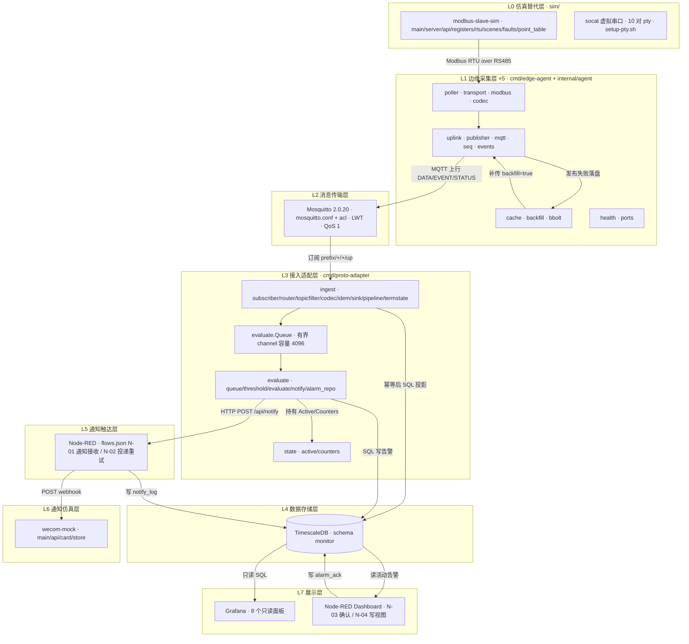

> **图 1-1　系统分层架构（真实组件版）。** 数据自 L0 的寄存器起，经 L1 换算上报、L2 分发、L3 落库与判定，落至 L4；判定产生的通知请求经 L5 触达 L6，界面读写分离地落在 L7。两个自研程序（L1、L3）之外均为锁版本开源件或仿真件。

### 1.2 交付件文件级模块明细

| 程序 | 文件 | 职责 | 关键类型 / 函数 |
|---|---|---|---|
| edge-agent | `cmd/edge-agent/main.go` | 入口与装配、启停顺序 | agentRuntime · run · shutdown |
| edge-agent | `cmd/edge-agent/serial.go` | 串口打开并注入 | openBuses · openBus |
| edge-agent | `cmd/edge-agent/settings.go` | MQTT 与主题装配 | resolveTopics · resolveMQTT |
| edge-agent | `cmd/edge-agent/cache.go` | 缓存参数、开队列、序号续接 | openCache · resumeSeq |
| edge-agent | `internal/agent/poller.go` | 总线轮询、批次产出 | BusPoller · Batch · PointReading · Collect |
| edge-agent | `internal/agent/transport.go` | 一帧收发 | exchange · readFrame |
| edge-agent | `internal/agent/modbus.go` | RTU 帧与 CRC16、异常码 | buildReadRequest · decodeReadResponse · ExceptionError |
| edge-agent | `internal/agent/codec.go` | 寄存器字换算工程值与质量码 | toEngineering |
| edge-agent | `internal/agent/uplink.go` | 报文头与报文体组装 | HeaderFor · DataBodyOf · EncodeUplink |
| edge-agent | `internal/agent/publisher.go` | 三类报文发布、失败落盘、设备事件驱动 | Uplink · SendBatch · persist · WillPayload |
| edge-agent | `internal/agent/mqtt.go` | 连接、遗嘱、退避重连、等 PUBACK | MQTTLink · Connect · Publish · Run |
| edge-agent | `internal/agent/seq.go` | 单调序号分配，重启续接不归零 | SeqAllocator · Next · ResumeTo |
| edge-agent | `internal/agent/cache.go` | bbolt 本地队列与三上限裁剪 | Cache · Append · Peek · Remove · trim |
| edge-agent | `internal/agent/backfill.go` | 按序号正序补传，PUBACK 出队 | Backfill · drain · PrepareBackfill |
| edge-agent | `internal/agent/events.go` | 设备离线/恢复事件判定 | deviceWatch · Observe |
| edge-agent | `internal/agent/health.go` | /healthz 只读快照 | HealthServer · HealthProbes |
| edge-agent | `internal/agent/ports.go` | 虚拟串口端点映射 | PortMap · Resolve |
| proto-adapter | `cmd/proto-adapter/main.go` | 入口与装配、订阅、生命周期 | run · newPipeline · newHandler |
| proto-adapter | `cmd/proto-adapter/evaluate.go` | 判定段装配与队列投递 | buildEvaluate · dispatch · dropWatcher |
| proto-adapter | `internal/adapter/ingest/subscriber.go` | MQTT 持久会话订阅 | Subscriber · Connect |
| proto-adapter | `internal/adapter/ingest/router.go` | 主题模板解析出终端与类型 | Router · Match |
| proto-adapter | `internal/adapter/ingest/topicfilter.go` | 由模板派生订阅通配 | TopicFilterFromTemplates |
| proto-adapter | `internal/adapter/ingest/codec.go` | JSON 解码、身份与质量码校验 | Decode · Row · Decoded |
| proto-adapter | `internal/adapter/ingest/idem.go` | 消息级幂等唯一落点 | Idem.Guard · Claimer.Claim |
| proto-adapter | `internal/adapter/ingest/sink.go` | 原文/历史/实时值/状态投影 | PGSink · WriteData · WriteRaw |
| proto-adapter | `internal/adapter/ingest/pipeline.go` | 接收段主编排 | Pipeline · Handle · guardAndWrite · Sweep |
| proto-adapter | `internal/adapter/ingest/termstate.go` | 终端状态三源合成、设备失败计数 | TermState · ApplyStatus · ApplyData · Sweep |
| proto-adapter | `internal/adapter/evaluate/queue.go` | 接收段与判定段的有界 channel | Queue · Push · Run |
| proto-adapter | `internal/adapter/evaluate/evaluate.go` | 阈值求值、去抖、告警状态机 | Evaluator · Evaluate · apply · raise · clear |
| proto-adapter | `internal/adapter/evaluate/threshold.go` | 阈值规则与不可变快照 | Rule · Snapshot · forPoint |
| proto-adapter | `internal/adapter/evaluate/notify.go` | 通知有界队列与 HTTP 发送 | NotifyQueue · HTTPSender |
| proto-adapter | `internal/adapter/evaluate/alarm_repo.go` | 告警表读写 | PGStore · Raise · Clear · CloseLower |
| proto-adapter | `internal/adapter/state/` | 活动告警集合与去抖计数 | Active · Counters |

> **表 1-2　两个自研交付件的文件级模块清单。** 共 34 个 go 文件（不含测试），全部通过构造函数注入外部资源（串口、MQTT、DB、时钟），模块内部不自建外部依赖。

---

## 2. 交付二：对象关系图（组件依赖）

依赖分两层：包级 import 边界决定什么不许依赖什么；运行期对象关系决定数据与控制怎么走。两层都从源码提取，边名即真实方法。

### 2.1 包级依赖

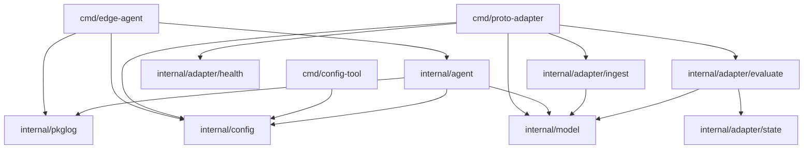

> **图 2-1　包级 import 依赖。** 箭头即真实 import。共享包只有 `internal/model`、`internal/pkglog`、`internal/config` 三个，`internal/config` 不反向依赖任何业务包。

**图中不存在的边才是边界：** `internal/agent` 与 `internal/adapter` 互相没有 import；`ingest` 与 `evaluate` 互相没有 import，两者唯一的连接是 `evaluate.Queue` 这条有界 channel，由 `cmd/proto-adapter` 缝合；`sim/` 不 import `internal/`，`cmd/` 不 import `sim/`。以上均由 `depguard` 在 `make lint` 强制。

### 2.2 edge-agent 运行期对象关系

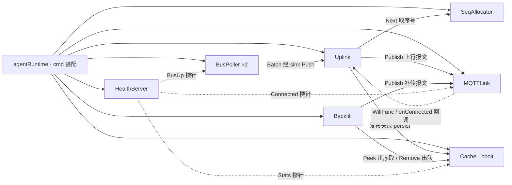

> **图 2-2　edge-agent 对象关系。** 采集循环（BusPoller）与上报循环（Uplink）只经有界内存队列衔接，互不等待；共享状态仅 SeqAllocator 与 Cache 两处。

### 2.3 proto-adapter 运行期对象关系

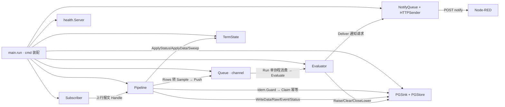

> **图 2-3　proto-adapter 对象关系。** 接收段（Pipeline）与判定段（Evaluator）之间只有 `Queue.Push` 一条边；判定段单消费者单写者，`Active`/`Counters` 不加锁；通知为异步单次发送，重试责任在 Node-RED。

---

## 3. 交付三：链路图（独立链路 + 总链路）

按对象关系图拆出 8 条可独立存在、独立验证的链路，编号 K1~K8，并映射回概要设计的数据流 F1~F7。

| 独立链路 | 对应概要设计 | 独立性依据 |
|---|---|---|
| K1 采集换算 | F1 前段 | 边缘进程内闭环，不依赖网络与平台 |
| K2 上行发布 | F1 中段 | 仅依赖 MQTT 连接，序号自持 |
| K3 缓存补传 | F2 | 独立协程 + 独立持久队列 |
| K4 接收落库 | F1 后段 | 平台进程内闭环，幂等自持 |
| K5 告警判定与触达 | F3 | 与入库经 channel 解耦，可独立消费 |
| K6 终端状态合成 | F4 | 三源输入独立于测点值判定 |
| K7 配置装载 | F6 | 启动/热载路径，与运行期数据流正交 |
| K8 展示与确认 | F7 | 只读/写分离出口，可独立操作 |

### 3.1 K1 采集换算链路

> 失败点也进 Batch（值空 + 真实质量码），绝不沿用旧值或填 0；超量程保留数值只改质量码。

### 3.2 K2 上行发布链路

> 出队凭据是 PUBACK 而非「已发出」；序号在缓存入队时即分配，断网期间 seq 持续递增。

### 3.3 K3 缓存补传链路

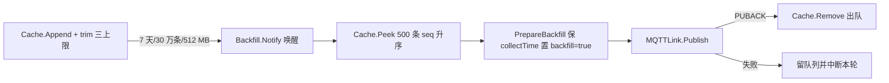

> 裁剪留痕：每满 1000 条发 CACHE_DROPPED，任一维度 80% 发 CACHE_WARNING；补传期间 RS485 采集循环不暂停。

### 3.4 K4 接收落库链路

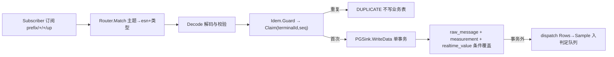

> 幂等判定在写任何业务表之前；实时值只被更晚 collectTime（或同时间更大 seq）覆盖，条件写在 SQL WHERE；补传行只进历史不进实时值。

### 3.5 K5 告警判定与触达链路

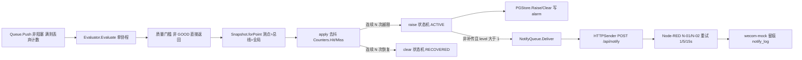

> 去抖与状态机是判定段核心：开关量不去抖、未恢复不重复拉响（去重键 `terminalId|pointId|alarmType`）；补传数据只记历史越限，不发通知。

### 3.6 K6 终端状态合成链路

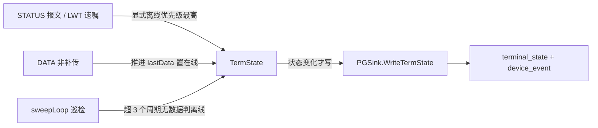

> 三源缺一都会误判：只看 LWT 时进程假死不掉线，只看数据超时时补传报文会误判在线；补传数据不推进 lastData。设备离线独立于终端离线：连续 5 次采集失败 MarkDeviceOffline，分别告警分别展示。

### 3.7 K7 配置装载链路

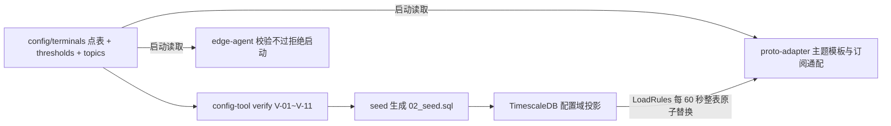

> 配置文件是唯一权威源，数据库是投影；只有阈值数值热载（60 秒原子替换），点表与串口参数变更需重启。

### 3.8 K8 展示与确认链路

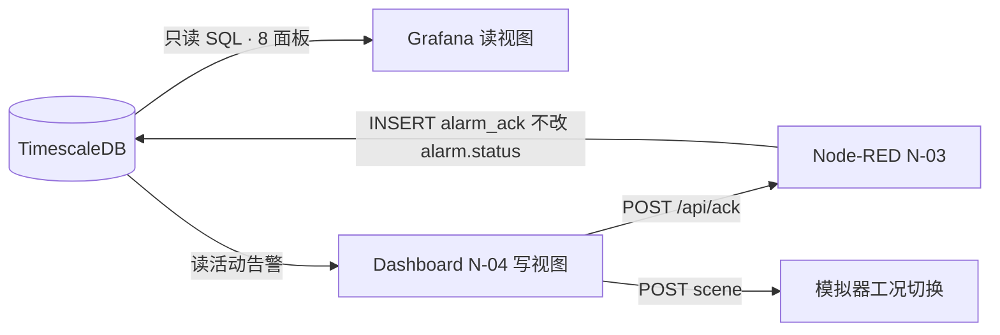

> 读视图持只读账号，写操作集中在 Dashboard 一个出口；确认只写 `alarm_ack`（ackedBy/ackedTime），状态机 ACTIVE→RECOVERED 由判定段负责。

### 3.9 总链路图

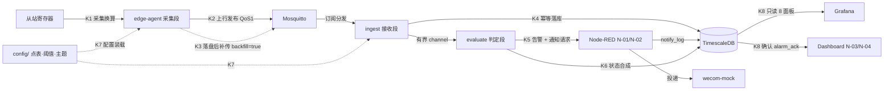

> **图 3-9　总链路图。** 八条独立链路在生产中并存：K1~K3 在边缘侧各自独立成环（采集不等上报、补传不等采集），K4~K6 在平台侧经有界 channel 两段解耦，K7 是正交的配置路径，K8 是读写分离的展示出口。任一链路故障的降级行为见概要设计 §2.8 故障域。

---

## 4. 交付四：时序图（独立时序 + 总时序）

参与者是真实组件，消息名是真实方法或真实报文类型；括号内为关键约束。

### 4.1 S1 正常采集周期时序（K1 + K2 + K4 + K5 前半）

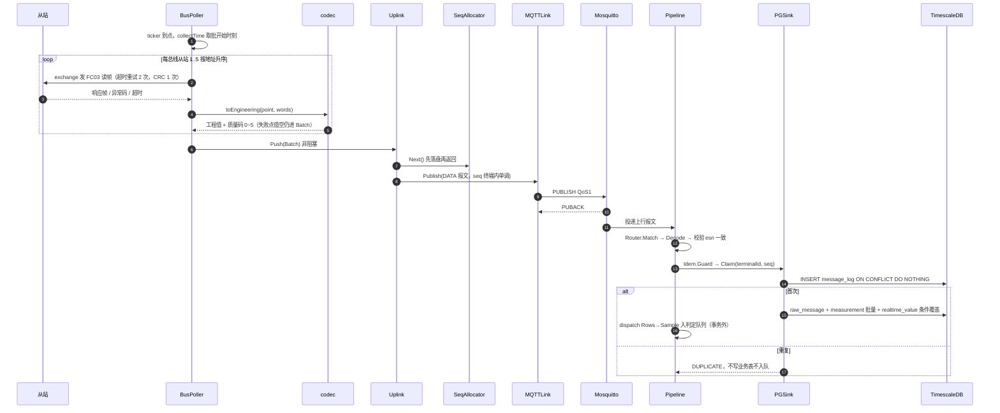

> 一个采集周期一条上行报文（14 点合批），全网 5 台终端 1 msg/s；同批测点共享同一 seq 与同一 collectTime。

### 4.2 S2 断网缓存与补传时序（K3）

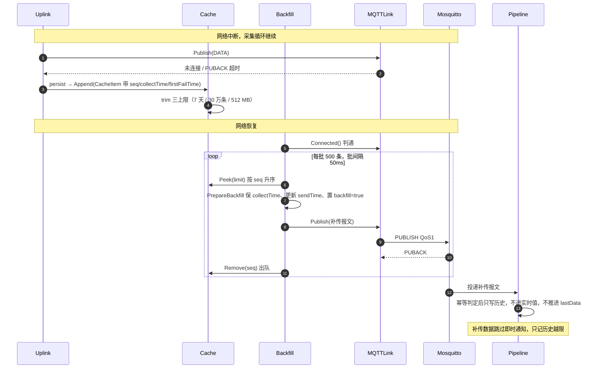

> 出队凭据是 PUBACK；序号不归零保证整段补传不被幂等判重；实时值「只进不退」由 SQL WHERE 的 collectTime 比较保证。

### 4.3 S3 告警判定与通知触达时序（K5）

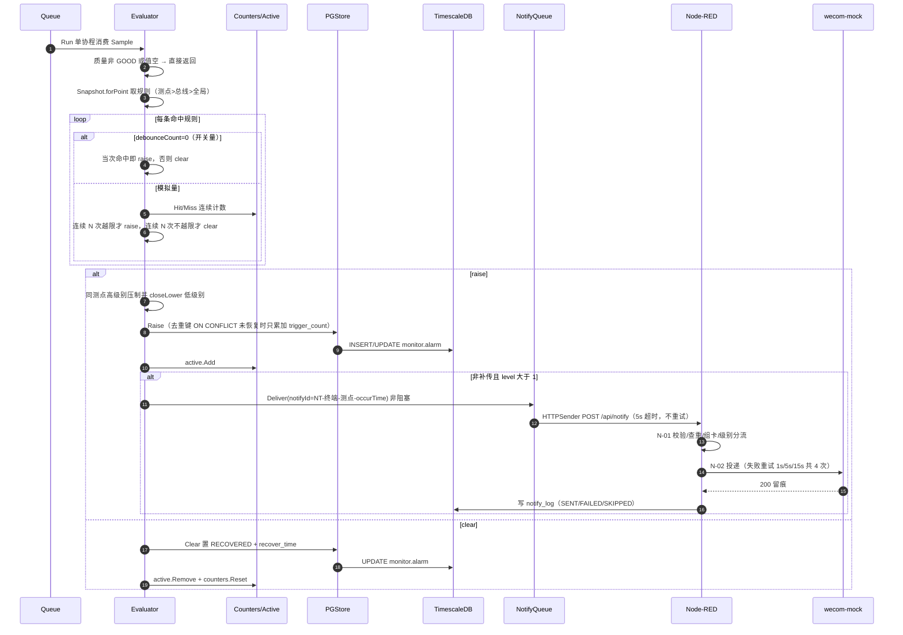

> 判定与触达分离：通知失败只留痕、不回滚告警、不回传判定段；同一去重键未恢复期间不重复拉响。

### 4.4 S4 终端状态三源合成时序（K6）

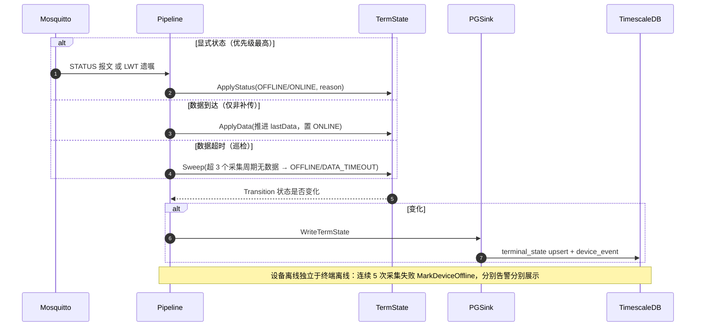

> 三源优先级：显式离线 > 数据超时 > 有非补传数据即在线。

### 4.5 S5 告警确认时序（K8）

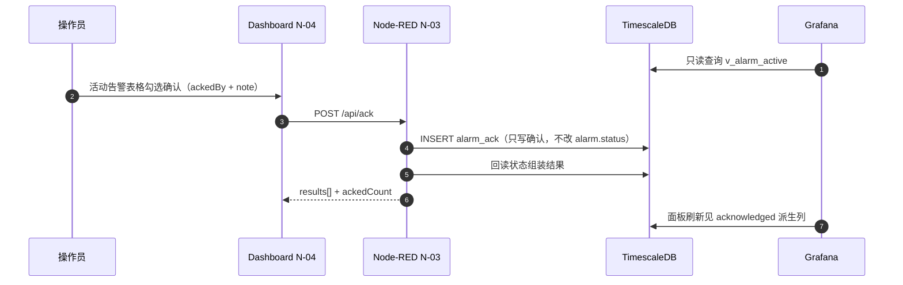

> 写出口唯一：确认走 `workshop_dashboard` 库角色，仅对 `alarm`/`alarm_ack` 可写；Grafana 全程只读。

### 4.6 S0 总时序（一轮采集到展示与触达）

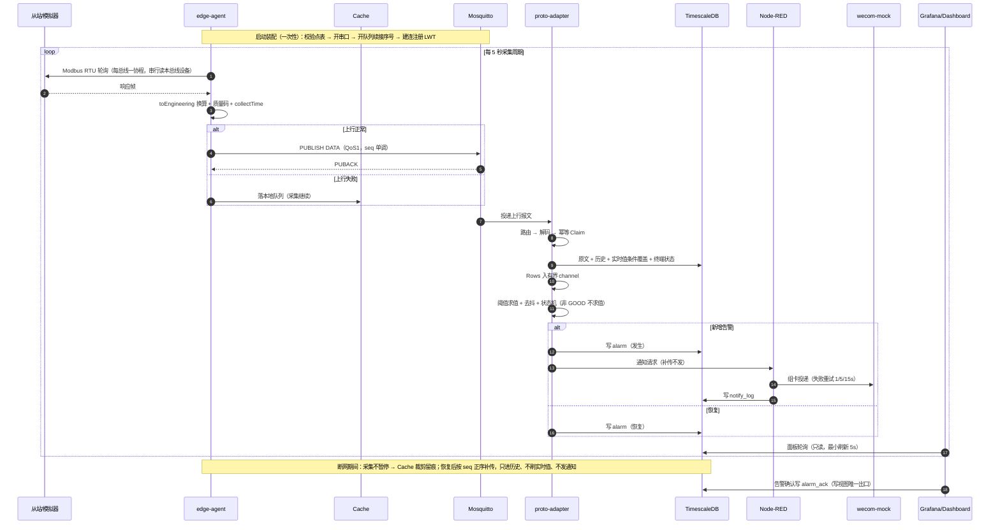

> **图 4-6　S0 总时序。** 一轮采集从寄存器到界面的完整生产路径，含断网补传分支与告警触达分支。时间轴一律以 collectTime 为准，接收时间只用于链路时延排查。

---

## 5. 归纳总结与文档偏差

1. **架构一句话。** 两个自研 Go 程序各守一段——边缘侧把寄存器变成带序号与质量码的上行报文（并保证断网不丢、恢复不重），平台侧把报文变成库里的测量、状态与告警（并保证幂等、只进不退、未恢复不重复告警）；中间是锁版本的 Mosquitto 与 TimescaleDB，外面是无业务判定的 Node-RED 与只读 Grafana。
2. **解耦点即测试点。** 三条缝（agent↔adapter 的 MQTT 报文、ingest↔evaluate 的有界 channel、evaluate→Node-RED 的 HTTP 通知请求）对应三条冻结线，也是四个验收 seam 的所在。
3. **状态归属清晰。** 会丢的状态（去抖计数）不持久化，不能丢的状态（活动告警集合、序号、缓存）各有重建或续接路径，全部在源码中有唯一落点（`Bootstrap` / `ResumeTo` / `Cache.MaxSeq`）。
4. **文档与实现的映射偏差（不影响功能，建议后续修订文档）。** 详细设计 §1.1 列出的 `mqttsink.go`、`codec_grid.go`、`codec_internal.go`、`sink_pg.go`、`debounce.go`、`statemachine.go` 是概念模块名，实际实现分别落在 `publisher.go`/`mqtt.go`、单个 `codec.go`（Codec 可切换）、`sink.go`、以及 `evaluate.go` + `state/`（去抖与状态机合并实现）；AGENTS.md 所述 evaluate「六件套」实为五文件，debounce 与 statemachine 不是独立文件。
5. **旁路构造器（概要设计 C3）在 `sim/` 下未实现**，当前仿真形态只有从站模拟器与 wecom-mock；Compose 中亦无 edge-agent / proto-adapter 服务（两者为宿主机进程），compose 实际只定义了 `sim` profile（wecom-mock），与部署规则中 sim/edge/core 三组的口径不同。
